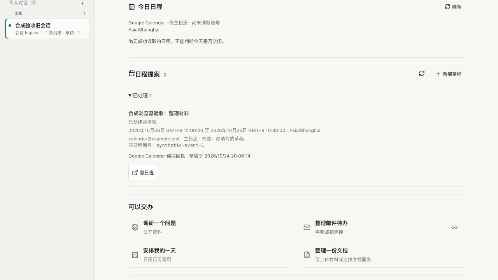
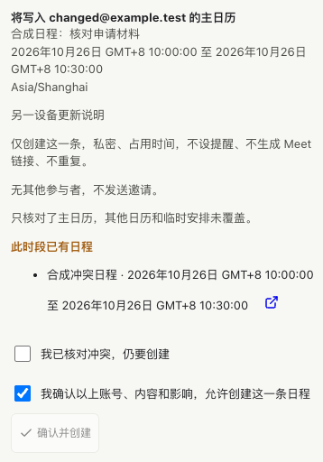

# P02.1 日程提案候选验收与 Review

状态：本地候选，尚未合并或部署。正式本机与 EC2 保持 P03.4 `fb45f15`。P02、M4 与整体 goal 均未完成。

## 本轮范围

补第一种具体业务动作：手动填写日程草稿、编辑/拒绝/稍后处理、核对主日历账号和冲突、确认具体版本、单次创建、读取并核验回执。不是开放任意工具调用的通用接口，不包含自动发送邮件、修改已有日程或模型自动生成提案。

实现复用既有 app-server、MCP 工具调用、原子 JSON 保存、串行队列、人工审批和发布锁；没有新建 AWS 资源、后台服务或调度器。Luxon 3.7.2 原本已由 cron-parser 安装，本轮声明为直接依赖以处理时区和夏令时，没有增加实际依赖包或改变锁定版本。

## 授权与证据边界

- 真实 EC2 CLI 0.157.1：两次独立、临时、只读协议探测已结束。核对工具目录与输入格式，并通过一次 `get_profile` 核对唯一已连接日历账号；没有读取日程、运行模型或修改日历。账号地址和连接标识保留在私有探测记录，不写入公开夹具。
- 工具目录确认 `search`/`fetch`/`get_profile` 为只读；`create_event` 为非只读。创建工具默认可能添加 Meet，遗漏提醒设置可能继承日历设置，因此参数明确关闭 Meet、默认提醒及参与者修改权限，指定私密、占用时间、无重复。
- **真实创建/读取输出尚未验收**，连接器没有提供可直接依赖的输出 schema（返回格式说明）。代码只接受可逐项核验的结果；未知、缺失或不一致均进入待核对，合成夹具不作为真实 Google 返回格式的证明。
- 已提出一次具体真实测试确认：既有账号主日历、2026-10-25 23:50–23:55（Asia/Shanghai）、“Codex Cloud 日程提案验收（自动清理）”、无参与者/提醒/Meet，最多 20 条冲突；无冲突才创建，读取后立即清理。**尚未获得该项答复，没有执行或复用旧的测试授权。**时间或范围变化必须重新确认。

## 安全与数据保护

| 场景 | 行为 |
| --- | --- |
| 保存草稿 | 仅核对连接账号和写入本项目私有记录，不创建日程 |
| 多设备同时编辑 | 绑定读取时版本；旧编辑被拒绝，页面保留输入 |
| 预览确认 | 显示账号、时区/偏移、起止、内容、参与者和副作用；5 分钟有效 |
| 已有冲突 | 单独勾选仍要创建；读取不完整时拒绝继续 |
| 执行前变化 | 重新核对账号、连接器参数和相同时段冲突，变化则使原确认失效 |
| 重复确认 | 已领取记录只返回原状态，不第二次调用创建工具 |
| 进程中断/回执丢失 | 持久领取先于写入；恢复为待核对，不自动重试 |
| 有编号但回执未核验 | 允许显式只读核验，不重新创建 |
| 人工核对 | 只记录用户说明，不冒充系统成功；执行中不能提前解除 |
| 原生权限请求 | 仅写入阶段的同线程 `codex_apps` 表单可进入既有人工审批；扩权、URL 或其他线程拒绝，结束只关闭自身审批 |
| 发布与回退 | 执行或待核对动作进入活动任务门禁；写入持有发布锁；不兼容旧版本不得自动忽略已有提案/回执 |
| 存储 | 100 条/2 MiB 上限、私有原子保存；损坏不覆盖；只有未执行草稿可经用户确认删除，执行记录不自动裁剪 |

默认仍只核对主日历，不能保证其他日历或临时安排空闲。执行前的最后核对不是 Google 端的原子事务，外部日历仍可能在最后核对后变化，页面不承诺绝对无冲突。全天回执若不能证明原时区，不视为已核验。

## 验收结果

- `npm run verify:local` 全量通过；最后的回退保护及回执核验调整又通过 12 项日程定向测试。先后修正新增模块导致的旧测试固定数量和审批测试注入遗漏，未放宽测试。
- 定向覆盖时区、夏令时不存在/重复时间、全天独占结束日、幂等草稿、并发编辑、来源变化、过期确认、冲突、领取前存储失败、中断恢复、回执丢失、不重复执行、线程审批隔离和不兼容回退。
- `verify:personal-calendar-actions:ui`：真实隔离控制台及本机 RPC 夹具完成保存、账号变化拦截、冲突二次确认、创建/读取、重复提交、丢失回执/人工核对和发布门禁；无真实模型或第三方写入。跨站请求返回 403。
- 1280/768/390/320 宽度：表单与确认区域无横向溢出，主要输入/按钮至少 44px。手机尺寸模拟不等于实际手机验收。
- 内置浏览器通过本机 HTTP 200 打开隔离控制台，实际完成草稿保存、预览、勾选、创建和展开回执；日期使用原生字段操作，DOM `fill` 对该字段未生效，未据此冒称实际日期交互失败。
- 最终运行包复验通过，97 个锁定依赖；新增模块在无构建依赖的独立目录可加载。首次扩展夹具遗漏 `run-budget.mjs`，已补复制并复验，这是夹具问题，不作为生产已通过的证据。GitHub CI 结果待下方追加。
- Review 发现本机代理通用 15 秒等待不足以涵盖核对和人工确认，已仅为固定日程动作 POST 路由延长至 130 秒并使用长请求连接池。TLS 合成上游验证长等待成功、断开的写入只调用一次，不扩大其他路由，不自动重放。
- 依赖审计：0 漏洞，锁文件仅多一项根直接依赖声明，实际运行依赖仍 97 包。

本轮页面证据均为合成数据：

## Review 与剩余门槛

结构按职责分为提案存储/校验、连接器操作/路由、页面三部分。未复制现有日程缓存和通用审批业务，读取结果解析共用原模块；连接器目录核对因动作包含不同权限契约，单独收口在动作连接函数，不改写已上线的只读缓存路径。

本轮 review 补了：损坏存储统一拒绝、摘要校验、冲突内容绑定、持久领取、非自身审批保护、正在编辑时禁止另一草稿覆盖、回执标识展示及不兼容回退门禁。目前本地已覆盖路径未发现遗留 P0/P1；真实返回格式和业务闭环仍未验证，不能把本地结果外推为生产安全保证。

下一步：获得具体真实测试确认后，先通过候选临时进程验证已知工具契约，记录实际输出并按需要修复；检查任务空闲、备份和健康/原数据对账后才正式发布。若结果不明，停止后续写入并报告，不为通过验收再次创建。然后再接模型提案与原始来源、邮件回复草稿、真实独立 API 客户端；不提前标记 P02/M4 完成。

## 对标复评

2026-10-24 复核 [Today 官方说明](https://today.ai/articles/blog/what-is-today)：其主张从日程和变化进入，提出行动草稿并在外发前取得确认。本候选补了具体账号/版本/冲突的可见确认，但仍需用户手填，尚未证明“自然语言交办→自动草稿→真实回执”的整条体验，不能称对等。

[Muse 官方产品设计](https://introducing.muse.ai/)强调跨工具完成任务、持续推进和低打扰通知；[Grok Bot 官方概览](https://docs.x.ai/grok-bot/overview)强调持久环境及真实工具执行。本轮只补单条日历创建，不扩张到云浏览器或交易；跨日质量、邮件闭环、真机及七天观察仍按原 goal 推进。竞品官方描述不是本项目或竞品可靠性实测。
