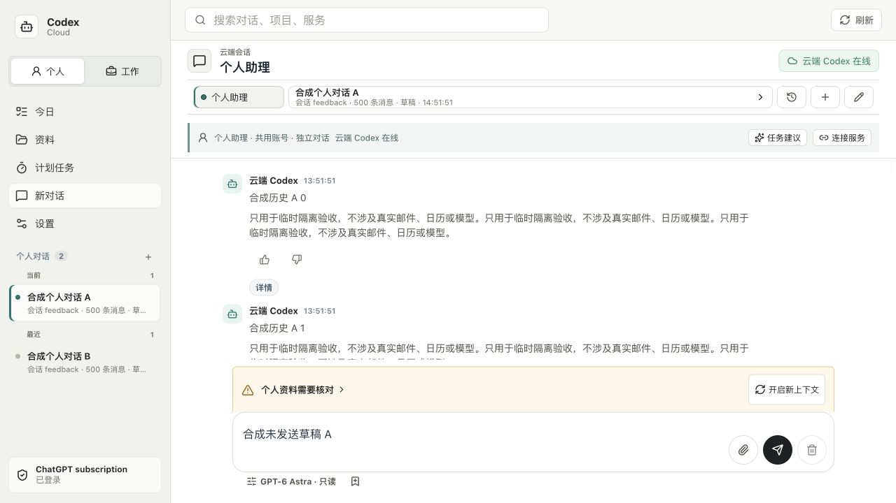

# 长对话历史范围与性能验收

最新状态：两轮本机严格性能通过，500 条温切换 P95 为 175/174ms；367 项本地（3 项 Linux 专属跳过）/17 组 HTTP、相关 UI、候选和主线 CI 通过，PR #24 已合并。EC2 构建通过，但限速下定向检查 14 项中 2 项失败，尚未发布；一次限时 CPU 对照验收已询问授权，不擅自增加费用风险。下文保留各阶段失败，不拿本机成功替代服务器验收。M2-M5、真机和七天观察仍未完成。

日期：2026-10-25，Asia/Shanghai。初版基线 `75e81c3`，候选分支 `codex/navigation-latency`；最终合并 `2bb1f56`，尚未部署。正式本机/EC2 仍为 `70b191f`，M2-M5 与整体 goal 保持未完成。

## 复现与实现

- 真后端接合成原生历史时，123 条只返回最后 80 条；500 条同样如此。原生记录仍在，但聊天页没有更早历史入口。不是消息已被服务器删除。
- 默认仍取 80 条，新增“加载更早的消息”，每次扩展 80 条；接口校验显示数量为 1–2000 的整数，返回实际总数和是否仍有更早内容。2000 条页面上限之外保留既有完整原生 JSON 记录入口，不宣称无限列表已实现。
- 展开数量复用已有标签页阅读记录，最多 40 个作用域，不保存第二份正文。通过原生线程编号区分个人/工作及会话；切换、刷新和后续消息到达后优先保留阅读锚点，超过显示上限或找不到锚点时明确提示，不猜测记录已被删除。
- GET 及原有选择接口沿用当前原生历史、运行时、草稿保护和请求代次检查。未知或其他项目的显式会话编号现在返回 404；此前返回的是空白成功，而非已证明泄露内容。
- 真实浏览器 CPU 采样发现每条消息重复构造时间格式化器；改为本页复用一个对象，格式及无效日期行为不变。浏览器系统时区改变后需重新载入页面以重建格式化器。
- 曾试验有界 Markdown 语法树缓存，500 条下收益有限，已移除实现、测试及直接依赖；最终依赖和原 Markdown 处理、复制/链接行为不变，没有留下并行缓存体系。

## 已取得证据

| 检查 | 结果 |
| --- | --- |
| 最终 `npm run verify:local` | 364 项，361 通过、3 项 Linux 专属跳过、失败 0；17 组 HTTP 回归通过 |
| 实际后端定向检查 | 500 条分段扩展、原始材料不改、显式 Astra/ultra 和草稿保持；非法数量/类型/锚点、未知/跨空间拒绝；新增记录保留锚点及 2300 条的有界回退 |
| 阅读回归 | 既有四尺寸阅读点、断网草稿、刷新、尺寸变化和新进展检查通过，模型/第三方调用 0 |
| 运行包 | 最终冻结源码复验通过：97 个锁定生产依赖，103,423,474 字节，与原运行包口径一致 |
| 桌面内置浏览器 | 本机 HTTP 200 后，实际从 80 扩为 160 条、入口与草稿可见，保存下方截图；为隔离数据，非生产页面或真机 |
| 500 条 UI | 1280×900、390×844 各 30 次温切换；逐步展开至 500、A/B 各自草稿/阅读点、刷新、追加 100 条、失败保留及迟到响应不串会话通过；性能尚未达标 |

早期 160 条入口截图保留在本地忽略目录；公开的 500 条合成页面截图见后续复验，不发布正式对话或账号画面。

## 性能口径

设备 Apple M4、24 GiB，macOS，Node 25.2.1；已安装 Chrome 的 headless 模式，生产构建、真实 Express 后端及固定原生 RPC 夹具，通过本机回环访问。每个原生线程 500 条，多数为短段落；不是 500 条复杂表格，也不是 100 个会话/30 天指标的完整 MOB-05。没有真实模型、邮件或日历调用。

温切换在浏览器内从路由意图开始，等目标消息、历史就绪、输入启用及下一绘制帧，不把控制脚本轮询时间算为页面延迟。首轮控制脚本轮询得出 265/216ms，改为页内计时后，原 80 条范围为桌面 134ms、手机尺寸 120ms；这不能作为 500 条通过证据。冷打开使用新浏览器上下文，不代表重启操作系统/浏览器进程或真实公网网络。

500 条的初次完整显示，桌面/手机尺寸温切换 P95 为 362/451ms；Markdown 缓存试验为 337/426ms，未达 200ms，因此没有保留。时间格式化器版本的一轮为 530/357ms，桌面有明显波动，不能宣称整体已加速。最终 30 次冷打开和 30 次温切换的逐样本复验正在进行，结果补记于下节；若目标不满足，严格性能模式以非零状态结束，不能用功能检查通过代替性能通过。

复验：`npm run verify:chat-history:ui -- --enforce-performance`。不带该参数只验证功能并报告独立的 `performanceOk`，不表示性能门槛通过。结果/截图位于忽略目录 `docs/research/acceptance/chat-history-window-20261025/`，测试自动停止自有后端并清理自有临时目录。

## Review 与失败记录

本轮为执行者自查，没有独立 review agent。检查数量限制、跨空间归属、旧请求代次、草稿与显式模型、显示范围/阅读点、2000 条边界、原生数据保持和运行依赖；没有增加数据库、任务或权限系统。

首次全量回归的两处旧 VM 夹具缺少新增状态 setter，已补齐并增加范围归属断言；后续时间测试遗漏 TypeScript 转译导致语法错误，也已修正，未弱化产品断言。UI 负例首次试图在刷新前清空阅读记录，但页面离开时会正确保存回去；现改用真正新标签页，不让测试绕过保存逻辑。原生历史截断与控制脚本计时误差分别保留，不把后一次成功当作未定位问题已消失。

## 发布与剩余门槛

候选不因绿色功能检查自动上线。500 条温切换目标仍未通过；冷加载、真实公网、实体手机、用户评价与七天真实观察需各自证据。后续应针对实际渲染/布局热点优化，不重新引入收益未经证明的缓存，也不裁掉历史来凑性能数字。生产独立 API 客户端等原 M2-M5 条件不改变。

## 最终复验

最终 `--enforce-performance` 完整跑完，功能检查通过、`performanceOk=false`，退出码 1；没有放宽 200ms 目标。两尺寸各 30 个独立新上下文冷打开、30 次温切换，逐样本保存在 `result.json`，日志 `/tmp/codex-chat-history-cold-warm-final-20261025.log`。

| 尺寸 | 冷打开 P50 / P95 / 最大 | 500 条温切换 P50 / P95 / 最大 | 结论 |
| --- | --- | --- | --- |
| 1280×900 | 267 / 806 / 878ms | 284 / 371 / 373ms | 冷目标通过，温目标失败 |
| 390×844 | 254 / 334 / 352ms | 317 / 375 / 403ms | 冷目标通过，温目标失败 |

没有控制系统其他任务或模拟手机 CPU，保留波动，不宣称各场景整体提速或真实手机通过。本轮完成的是更早记录可访问、阅读窗口恢复、拒绝和性能证据；下一步优先处理 500 条的实际渲染/布局成本，不裁掉记录凑数字。保留候选，不合并或部署；正式数据、任务、模型与权限未改。

源码冻结后又通过原有阅读 UI 回归和较广安全 UI（含长历史输入不重绘、快速切换、草稿/上传、Review 操作保护）；运行包再次通过。最初 502 后的一次正式严格健康检查已返回 200、`strictOk=true`、`partial=false`，这不证明网络根因消失，也未重启正式服务。清理并核对了本轮自有临时标签页/服务，不关闭用户原标签页；新性能严格检查的失败记录保留。

## 屏外渲染修复与复验

旧候选 `09adb60` 的 [CI 40170211006](https://github.com/WilsonWang01/codex-cloud-console/actions/runs/40170211006) 成功，只证明该旧版本的既有回归，不证明下述新改动或页面性能。

真实浏览器计数发现 6 次切换触发 2,988 次 SHA-256 内容校验。评价现在在回复接近聊天可见区时才校验，校验前仍不可提交；回合/线程/正文/版本与服务器复核保持。取消、迟到结果、校验失败及不支持可见性观察时的即时回退均有可执行检查；没有增加持久数据或依赖。一次同类采样仅 15 次校验；采样耗时同时受其他浏览器影响，不拿它做速度 A/B 结论。

使用浏览器原生 `content-visibility: auto` 和可记忆的块高度估计跳过屏外布局，流式消息不启用。500 条消息仍在 DOM，未截掉内容或添加第二套消息缓存；不支持这些 CSS 的浏览器保持原布局。设计依据是 [W3C CSS Containment 的自动渲染规则](https://www.w3.org/TR/css-contain-2/#using-cv-auto)，实际效果仍以本次浏览器证据为准。

首次原生布局试验出现 flex 项高度压缩，已明确设置不收缩；随后自动化直接滚动未绘制子段落失败，改为先滚动同一消息容器、再定位原段落，保留原阅读锚点和 8px 误差断言。原有阅读/断网/尺寸回归恢复通过，没有为通过而放宽定位标准。内置浏览器曾碰到本地构建临时清空 `dist` 的 404；构建完成、HTTP 200 后重新验证，最终真实页面可以展开到 500 条并看到第 0 条，非永久加载或生产故障。

| 严格复验 | 桌面冷 P95 / 最大 | 桌面温 P95 / 最大 | 手机尺寸冷 P95 / 最大 | 手机尺寸温 P95 / 最大 |
| --- | --- | --- | --- | --- |
| 第一轮 | 282 / 777ms | 194 / 239ms | 234 / 235ms | 185 / 190ms |
| 第二轮 | 318 / 1248ms | 175 / 188ms | 227 / 229ms | 174 / 174ms |

每轮每尺寸各 30 冷/30 温样本，两轮 `functionalOk=true`、`performanceOk=true`、退出 0；桌面/手机尺寸的 32 次含预热切换只触发 192/160 次评价校验。展开、A/B 草稿与阅读点、刷新、100 条后续消息、失败/迟到响应，以及 501 条富内容下的长消息、代码块、表格和图片加载均通过；图片复用仓库合成 PNG，以受限路由夹具返回，只证明绘制/加载，不代表真实模型图片生成或生产文件链路。

公开的[前后样本与源文件哈希](evidence/2026-10-25-navigation-samples.json)可独立核对分位数，未包含用户正文或账号。最终本地 367 项：364 通过、3 项 Linux 专属跳过、失败 0；17 组 HTTP 和五尺寸评价 UI 通过。冻结源码后的运行包检查通过（97 个锁定依赖，103,423,474 字节），较广安全 UI 也通过，覆盖快速切换、输入/上传/草稿、长历史、Review 状态归属与三种还原确认。没有真实模型、邮件/日历调用或业务写入。尚待最终候选 CI 与安全发布核对；本机回环性能不是公网/真机或整体 goal 完成证明。

最终自查核对了观察器取消与降级、可见区校验一次性、流式布局排除、消息不收缩及草稿/阅读点恢复；未发现新的阻止本次候选发布的问题。本轮没有独立 review agent，不把执行者自查称为独立审查。原 200ms 指标、范围限制和拒绝断言未放宽。

## 合并与发布准备

最终候选 `cbd7caa` 的 [CI 40174342421](https://github.com/WilsonWang01/codex-cloud-console/actions/runs/40174342421) 及合并版本 `2bb1f56` 的 [CI 40174671437](https://github.com/WilsonWang01/codex-cloud-console/actions/runs/40174671437) 均成功；[PR #24](https://github.com/WilsonWang01/codex-cloud-console/pull/24) 已合并。合并提交与候选源文件相同。正式服务切换前仍需独立准备、空闲复查及恢复验证。

发布前只读检查：原 34 会话/200 运行仍在，严格健康通过，直接本机 HTTP 确认任务/压缩/来源读取/原生请求均为零。临时入口保护的本机测试因未安装 Caddy 不能执行；转为 EC2 上独立回环夹具，验证写入/WS 限制、操作通道保留、不影响其他域名、重复清理及并行变更保护通过，没有改变正式入口。新包使用独立目录和 CPU/内存限制准备，未覆盖旧源码目录或用户工作区。

首次准备 `codex-p044-prepare-20261025-r1` 在切换前失败：我设置的 640 MiB 进程组上限使 Node 默认堆约 256 MiB，TypeScript 编译发生堆不足。旧服务仍为 `70b191f`，没有执行维护入口或重启，源目录与 CLI 配置哈希保持。失败结果与 unit 保留；只读确认可用内存约 1.1 GiB 后，第二次准备复用本轮干净源码，CPU 上限仍为单核的 15%，内存上限 768 MiB、子进程堆 512 MiB，定向检查串行执行并关闭这次临时进程的 core dump。未扩容实例、购买资源、删除旧数据或重置额度；这不是模型或产品回归已通过的替代证据。

第二次准备 `codex-p044-prepare-20261025-r2` 的编译、schema 和 normalizers 通过。14 项定向检查中 12 通过、2 失败：500 条历史夹具未在原 15 秒内就绪；评价 HTTP 的历史读取返回 503 而非 200。限速是主要怀疑，但尚未完成同一 EC2 上正常 CPU 预算的对照，不能仅凭本机和 CI 成功把它归为已排除的环境故障。没有延长产品/测试超时、忽略失败或继续执行部署，原失败结果保留在 `prepare-final.json`。后续 17 组 HTTP 和运行包检查因前置失败未执行，不记为 EC2 通过。

已询问一次最多 1 核/5 分钟、内存 768 MiB 的模拟验收许可，明确 AWS CPU 突发积分可能产生费用；不扩容、不运行模型、不修改第三方数据或重启正式服务。未获确认前保持原上线版本，不将“已合并”写成“已发布”。本机新运行包仅准备于私有目录，既有代理 LaunchAgent 未切换；本轮未创建发布备份、未执行入口维护或回滚覆盖数据。
