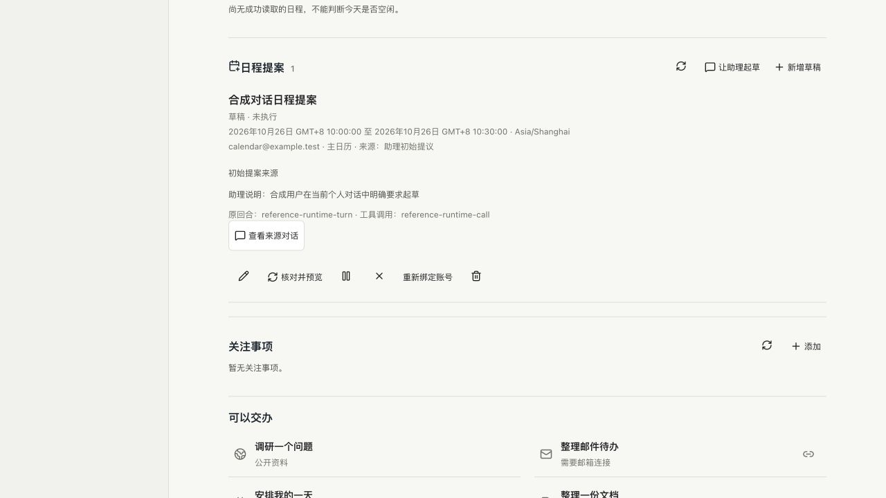

# P02.2 对话日程提案验收与 Review

状态：候选开发完成，尚未部署。延续 PR #8；正式本机与 EC2 仍为 `fb45f15`。本轮从手填草稿推进到对话起草和来源回看，不将合成测试当作真实模型理解质量或 Google 业务成功。

## 已实现

- 新个人上下文注册 `personal_calendar_propose`，只保存待核对草稿。工作、后台、旧回合、取消中及不匹配线程的调用拒绝；账号核对期间回合结束时也拒绝落盘。
- 标题、完整本地日期/时间、时区和参与者等信息需明确；缺失或夏令时重复时间要求补充。模型不能传入确认、执行、账号或自选来源字段。
- 服务端记录真实会话/线程/回合/工具调用标识及模型说明、原始内容摘要。每回合最多 3 条；同调用重放返回原记录，不覆盖用户编辑，不恢复拒绝状态，不重复核对账号。
- 今日“让助理起草”只准备新个人消息，不自动发送或调用模型；聊天可跳到提案，提案可回来源对话。新草稿优先展示，来源与当前编辑内容分开；仅原生完成回执且来源和参数匹配才显示入口。
- 实际页面发现待核对提案未计入今日摘要，已纳入“需要你决定”；读取失败保留未知状态，不能显示没有待办。
- 提案文件读取旧版 1，首次保存模型来源后才使用格式 2；旧草稿不因读取而改写。不兼容版本回退被阻止，原数据保留。没有新建并行的记忆、审批或任务系统。

## 已验收

1. 全量 `verify:local` 通过；新工具 8 项、日程动作 12 项定向通过。曾发现旧回归测试仅列两个动态工具，已增加预期新工具，继续保留工作空间不注册工具的断言。
2. 真 CLI 0.157.1 + 回环合成 Responses 服务：注册、一次工具调用、草稿保存、重启恢复和原生历史回执通过。使用无账号的临时 HOME；每种合成检查 2 次本机服务请求，真实模型调用 0，不消耗用户模型推理额度。原记忆候选和资料引用两条同类检查复验通过。
3. 真实隔离控制台 + 固定 RPC 夹具：从今日入口准备消息、人工发送、原生工具到草稿、聊天跳提案/回源、重载、用户编辑/拒绝保留来源通过；只运行 1 个固定合成回合，没有真实模型或日历写入。
4. 1280/768/390/320 宽度及 320×480 短屏，无横向溢出、主要入口不少于 44px；是尺寸模拟，不是真机验收。内置浏览器通过本机 HTTP 实际完成起草消息、保存、跳转和来源展开。
5. 独立运行包可加载新模块，实际依赖仍 97 包。未升级模型、CLI 或任何 AWS 资源，未改原项目、任务和显式设置。

## 真实日历测试授权

2026-10-25 用户明确允许一次既有指定账号主日历的测试：2026-10-25 23:50–23:55（Asia/Shanghai），标题“Codex Cloud 日程提案验收（自动清理）”，最多 20 条冲突信息；无冲突才创建 1 条，无参与者、提醒和 Meet，读取回执后立即清理。不调用模型，超时或结果不明停止写入，不重试创建。

本报告初次提交时尚未执行。后续在独立私有测试状态验证实际连接器输出并追加结果；不让候选与正式后端共同写生产提案文件。生产发布仍须 CI、空闲检查、备份校验、严格健康与原数据对账。

## 边界与下一步

本工具的保存回执只证明草稿已保存，不证明原始用户意图被模型正确理解、日历空闲或行动成功；来源说明是模型说明，非人工授权。旧会话不强行改写工具列表，必要时沿用既有新上下文流程。

原生 MCP 其他调用仍走既有审批/待核对机制；本工具不是对 CLI 所有第三方工具的全局安全隔离证明。完成固定个人安全场景时仍需单独核对，不能凭这个受控入口判定所有外部写入路径均已覆盖。

日历真实创建/清理、模型理解与追问、邮件草稿、API 真实独立客户端、真机、七天观察及用户评价仍未完成。P02/M4 与整体 goal 不提前结束。下一步先完成已获具体授权的日历业务测试，再按证据决定修复及发布。

实现依据：[OpenAI app-server 官方说明](https://learn.chatgpt.com/docs/app-server)的线程动态工具和原生回执流程；不会把已验证的协议往返当作真实模型质量证明。
