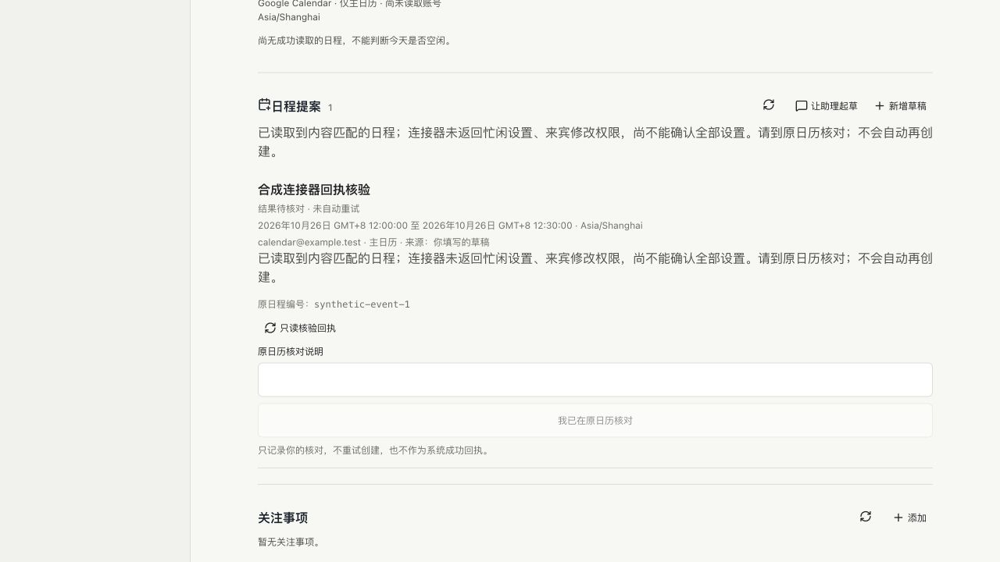

# P02.2 对话日程提案验收与 Review

状态：候选开发完成，尚未部署。延续 PR #8；正式本机与 EC2 仍为 `fb45f15`。本轮从手填草稿推进到对话起草和来源回看，不将合成测试当作真实模型理解质量或 Google 业务成功。

## 已实现

- 新个人上下文注册 `personal_calendar_propose`，只保存待核对草稿。工作、后台、旧回合、取消中及不匹配线程的调用拒绝；账号核对期间回合结束时也拒绝落盘。
- 标题、完整本地日期/时间、时区和参与者等信息需明确；缺失或夏令时重复时间要求补充。模型不能传入确认、执行、账号或自选来源字段。
- 服务端记录真实会话/线程/回合/工具调用标识及模型说明、原始内容摘要。每回合最多 3 条；同调用重放返回原记录，不覆盖用户编辑，不恢复拒绝状态，不重复核对账号。
- 今日“让助理起草”只准备新个人消息，不自动发送或调用模型；聊天可跳到提案，提案可回来源对话。新草稿优先展示，来源与当前编辑内容分开；仅原生完成回执且来源和参数匹配才显示入口。
- 实际页面发现待核对提案未计入今日摘要，已纳入“需要你决定”；读取失败保留未知状态，不能显示没有待办。
- 提案文件读取旧版 1，首次保存模型来源后才使用格式 2；旧草稿不因读取而改写。不兼容版本回退被阻止，原数据保留。没有新建并行的记忆、审批或任务系统。

## 已验收

1. 全量 `verify:local` 通过；新工具 8 项、日程动作 12 项定向通过。曾发现旧回归测试仅列两个动态工具，已增加预期新工具，继续保留工作空间不注册工具的断言。
2. 真 CLI 0.157.1 + 回环合成 Responses 服务：注册、一次工具调用、草稿保存、重启恢复和原生历史回执通过。使用无账号的临时 HOME；每种合成检查 2 次本机服务请求，真实模型调用 0，不消耗用户模型推理额度。原记忆候选和资料引用两条同类检查复验通过。
3. 真实隔离控制台 + 固定 RPC 夹具：从今日入口准备消息、人工发送、原生工具到草稿、聊天跳提案/回源、重载、用户编辑/拒绝保留来源通过；只运行 1 个固定合成回合，没有真实模型或日历写入。
4. 1280/768/390/320 宽度及 320×480 短屏，无横向溢出、主要入口不少于 44px；是尺寸模拟，不是真机验收。内置浏览器通过本机 HTTP 实际完成起草消息、保存、跳转和来源展开。
5. 独立运行包可加载新模块，实际依赖仍 97 包。未升级模型、CLI 或任何 AWS 资源，未改原项目、任务和显式设置。

## 真实日历测试授权

2026-10-25 用户明确允许一次既有指定账号主日历的测试：2026-10-25 23:50–23:55（Asia/Shanghai），标题“Codex Cloud 日程提案验收（自动清理）”，最多 20 条冲突信息；无冲突才创建 1 条，无参与者、提醒和 Meet，读取回执后立即清理。不调用模型，超时或结果不明停止写入，不重试创建。

本报告初次提交时尚未执行，后续结果如下。测试来源是 `4070bbb94722898ca6a7c5c6658c8adda3e8d567`，其 [Linux CI 40112325673](https://github.com/WilsonWang01/codex-cloud-console/actions/runs/40112325673) 已成功结束。使用 EC2 独立私有测试目录和提案文件，不与正式后端共同写生产提案状态。

## 真实测试结果与修复

| 项目 | 实际结果 |
| --- | --- |
| 账号与时段冲突 | 核对为获准的同一账号、主日历和五分钟时段；创建前两次查询均无冲突 |
| 创建次数 | 仅 1 次，返回日程编号；单独读取证明标题、起止、私密、无其他参与者、关闭提醒和无 Meet 链接符合批准范围 |
| 应用完整成功核验 | **未通过**。连接器使用 `use_default` / `guests_can_modify`，空说明变成空白行；读取结果没有报告忙闲设置，来宾修改权限为 `null`，不能推断为已验证的默认值 |
| 不确定状态 | 持久记录为 `needs_reconciliation`（需要核对），保留原编号，没有重试创建 |
| 清理 | 只删除这同一条已确认的测试日程，删除工具返回 `isError=false` 和“操作完成”；旧测试操作脚本误把纯确认当作日历数据，因而在清理后查询前停止 |
| 清理复核 | 另启只读核对，禁止创建、删除和模型调用；确认同账号、同日历、同一时段不再包含该编号。最终 **创建 1、删除 1、额外写入 0，清理已确认** |
| 读取与模型 | 三次时段查询累计返回 0 条记录，未扩大范围或翻页；真实模型调用 0 |
| 原有数据与服务 | 7 项受保护路径的内容哈希/缺失标记一致；正式服务没有重启，健康返回 HTTP 200、`strictOk=true`、`partial=false` |

原始账号、连接标识、日程编号和工具回执保留在私有验收目录，不写入公开测试夹具。该次具体创建授权已经用完，不授权第二次创建。

本轮修复只做以下必要调整，没有修改持久格式或增加依赖：

- 接受明确的大小写命名差异和空白说明；两个别名值矛盾时拒绝核验。补充蛇形命名的 Meet 字段检查，不能因只查另一种命名而漏掉会议链接。
- 缺失忙闲/来宾权限时保留待核对，并明确显示缺少的信息，不把 `null` 或未报告字段当作安全默认值。
- 回执中不能忽略标记为本人的参与者；原请求明确省略自身出席，任何未确认的参与者都不能靠该标记消失。异常重复规则、缺失参与者列表也不能算成功。
- 修复实际浏览器发现的两个问题：待核对记录计入提案数字；只读复核未通过后，重新读取本项目保存的记录，保留“需要你处理”入口与用户输入。不自动重试第三方动作。
- 没有放宽共用的日历读取解析器。仅有“操作完成”的普通文字仍不是完整日历数据；删除的动作确认与删除后的只读业务验证分开记录。

修复后 21 项定向测试、全量 `verify:local`、构建、97 包独立运行包通过；之后的前端数字/错误状态调整又通过构建与真实隔离 UI 复验。页面覆盖明确字段、缺失字段、重载、只读复核不重复写入、待核对发布门禁及 1280/768/390/320 宽度，连接器为合成数据，不宣称真实手机或真实模型理解质量通过。内置浏览器实际复现并复验了提案数字和处理入口问题。

对话起草 UI 追加复验曾在夹具启动前的跨空间断言收到 `ok=false`，尚未复现和定位原因；没有降低断言，补充错误诊断后单独重跑通过。记录为验收夹具/启动路径的待观察项，不能把后一次通过表述为已解决偶发失败。构建保留既有主包超过 500 kB 的提示，本轮未处理。

**发布决定：不部署当前 P02 候选。** 创建和清理测试完成，不等于应用已经取得完整成功证明；先评估现有只读工具能否取得缺失字段，若不能则收敛能力说明与人工核对流程，不能为取得绿色结果而猜测默认值。正式本机与 EC2 继续保留 `fb45f15`。生产发布仍须 CI、空闲检查、备份校验、严格健康与原数据对账。

## 边界与下一步

本工具的保存回执只证明草稿已保存，不证明原始用户意图被模型正确理解、日历空闲或行动成功；来源说明是模型说明，非人工授权。旧会话不强行改写工具列表，必要时沿用既有新上下文流程。

原生 MCP 其他调用仍走既有审批/待核对机制；本工具不是对 CLI 所有第三方工具的全局安全隔离证明。完成固定个人安全场景时仍需单独核对，不能凭这个受控入口判定所有外部写入路径均已覆盖。

日历指定测试的真实创建/清理已完成，应用完整回执证明仍未通过；模型理解与追问、邮件草稿、API 真实独立客户端、真机、七天观察及用户评价仍未完成。P02/M4 与整体 goal 不提前结束。下一步优先解决缺失设置的证明与能力边界，再决定安全发布范围，不复用已消耗的真实创建授权。

实现依据：[OpenAI app-server 官方说明](https://learn.chatgpt.com/docs/app-server)的线程动态工具和原生回执流程；不会把已验证的协议往返当作真实模型质量证明。
