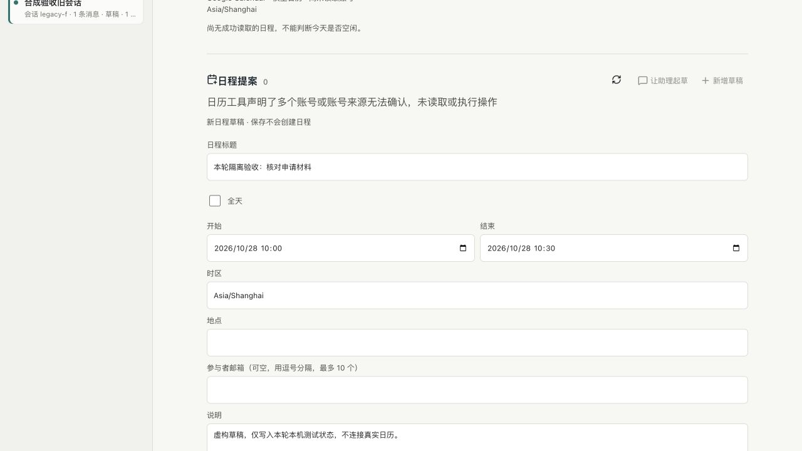

# P02 候选整合与多账号门禁

日期：2026-10-26，Asia/Shanghai。复用[草稿 PR #8](https://github.com/WilsonWang01/codex-cloud-console/pull/8)，没有另造日程提案、审批或执行系统。旧候选 `8b50b5b` 与主线 `3409975` 整合，保留邮件来源、回合归属、取消去重、阅读恢复及回调改进。最终头提交与 CI 以 PR 的本轮回执为准，不复用旧候选绿色检查。

**仍是草稿，不合并、不部署。** 旧真实测试已创建并清理，但忙闲和来宾权限字段没有取得完整证明；本轮没有放宽这一成功门槛，也没有再创建真实日程。M2-M5、固定个人场景、真机和七天观察均不提前完成。

## 发现与修复

动作连接仅检查主要 `link_id`，遗漏了工具声明的 `link_accounts`；只读日历来源已有对应检查。新定向用例实际失败为 `Missing expected rejection`：声明空列表、其他账号或多账号时，旧候选仍保存草稿。

现在对四个实际使用的工具分别核对可选账号列表：如果提供，必须恰好一个且与已绑定标识相同。格式错误、空、范围不符或多个账号均在读取账号身份、保存提案和尝试写入之前拒绝。未提供列表的旧契约仍需满足原来的唯一账号、同连接标识、实际账号身份和参数契约检查；不是忽略归属。预览后账号列表变化也拒绝执行，原记录保持未尝试。

整合时手工处理 11 个文件的 16 处冲突。日程动作的人工表单分支与主线的回合归属、取消和受限任务拒绝共同保留；新增路由检查覆盖只有所属日程线程能进入审批，其他服务器、URL 表单、扩权和无归属线程仍拒绝。没有改已有会话、模型档位或执行权限。

## 失败与复验

- 首次两条页面检查都未进入页面：旧夹具期待跨项目会话返回成功空结果，当前主线明确返回 404。按实际契约验证 404、最小错误字段，再单独核对正常会话列表不含外空间线程；未修改生产后端来迁就测试。不能据此宣称此前所有偶发启动失败已经定位。
- 第一轮完整回归的延迟模块数量仍为旧值 12，整合邮件与日程入口后实际为 13；更新明确数量，保留禁止直接 `lazy`、局部恢复和不自动刷新检查。
- 第二轮完整回归发现旧审批 VM 夹具漏注入日程动作对象。核对全部调用处，补注入和日程所属线程的路由正反向检查，不删原取消/失效审批断言。
- 对话回源检查两次直接读取父聊天容器为空；屏外消息使用 `content-visibility: auto`。仅等待 DOM 中目标可见仍不足以使父容器文本成为有效断言。最终将目标消息实际滚入视区、截图，再严格比较更正后的完整文字；未关闭按需渲染或放宽内容要求。
- 一次本机 CLI 目录探测在 30 秒超时，业务工具和模型调用均为 0，进程已关闭、共享配置未变。固定 CLI 0.157.1 的生成参数没有新文档中的 `serverName`，不假设此次过滤生效，也不凭目录推断替代读取工具能返回缺失设置；没有反复重试或绕过登录。

## 验收证据

私有日志与截图：`~/.codex/acceptance/p02-integration-20261026-r1/`。失败日志保留，不以重跑通过隐藏首轮结果。

| 范围 | 本轮实际结果 |
| --- | --- |
| 定向动作与来源 | `targeted-final.log`：22/22，包含四种工具的错误账号列表、明确单账号及预览后变化；来源读取前拒绝，不保存或写入 |
| 审批 | `approvals.log`：10/10，原回合取消/失效、只读来源与日程所属线程保护通过 |
| 完整本地 | `local-r3.log` 退出 0：399 项，396 通过、3 项 Linux 专属跳过、失败 0；18 组综合流程 `scope=all` 全通过，末尾 GitHub 隔离检查通过 |
| 动作页面 | `ui-actions-r2.log`：真实隔离控制台与固定 RPC；账号拒绝/输入保留、修改冲突、明确确认、重复操作、丢失及缺失字段回执保护、四宽度通过；3 次创建仅在虚构连接器内 |
| 对话来源页面 | `ui-model-r4.log`：一个固定合成回合，起草、保存、回源、重载、更正与拒绝通过；320/390/768/1280px 及短屏检查，不是真机 |
| 真实 CLI | `native-calendar.log`：CLI 0.157.1，私有无账号 HOME、2 次本机受控请求、工具草稿与来源持久化/重启恢复通过；真实模型和日历写入 0，新增独立 CI 步骤 |
| 运行包 | `runtime.log` 退出 0：97 个锁定运行依赖、103,423,474 字节，与整合前包数保持；已有 Luxon 只增加直接声明，不新增实际包 |
| 内置浏览器 | 仅本机 HTTP 隔离服务：填写日期/标题，触发多账号拒绝并保留输入；恢复测试账号后保存/预览，未确认时创建按钮禁用。直接核对 1 条未尝试草稿、0 创建、0 模型；保存截图后关闭标签和服务，原端口已不可访问 |
| 正式环境 | 只读版本查询 HTTP 200，正式仍 `70b191fc26d5450d36bd2b0c11f6e9d7491ac417`；未操作 EC2、重启或做全量生产数据对账，不将查询成功扩大为发布验收 |

执行者自查，无新增独立 review agent。重点核对主线审批与取消保护、账号归属、持久领取先于写入、旧确认失效、异常不重试、未知回执与原状态保护；只有本轮实际覆盖的范围通过。

## 剩余门槛

真实设置回执缺失仍未解决。已另行请求一次有明确账号、日期和清理限制的新测试授权，用于判断其他只读读取路径；未答复前不执行，不复用已消耗的旧授权。不能把本轮合成成功当作真实日程成功或个人固定用例整体通过。

生产独立 API、真实图片与公网回调、完整邮件草稿、固定 20 场景、实体手机、七天真实使用和用户评价继续保留。EC2 限时 CPU 费用确认等原门禁不变，原生 goal active；不因无法取得真实证据而改定义或继续增加可选功能。

协议核对参考[官方 OpenAI App Server 文档](https://learn.chatgpt.com/docs/app-server)；实际实现仍以固定 CLI 的生成契约和运行结果为准，不能用新版文档推断旧版本已经支持某个参数。
