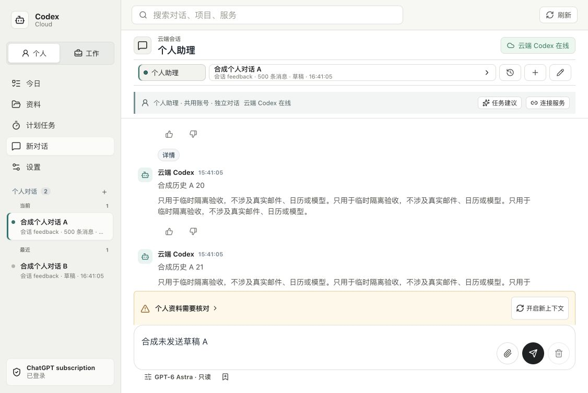

# 中宽桌面聊天布局修复验收

基线为正式版本 `2bb1f56`，分支 `codex/compact-chat-layout`。本轮只改聊天容器的两条 CSS 高度声明，增加现有阅读 UI 检查并纳入 CI；不修改后端、依赖、鉴权、任务格式、模型、凭据或生产数据。发布及最终 CI 回执待补充，不能把本地通过写成已上线。

## 复现与实现

- 未修复时，1126×753 的隔离实际控制台中，聊天区约 11,284px，输入框约 y=11,598–11,662；新增检查退出 1。不是只看截图或审阅 CSS 推断问题。
- 通用页面在 `max-width:1180px` 下使用自动高度，聊天页面继承后被长历史撑开。只在同一媒体区间为 `.session-content-grid` 恢复 `height:calc(100dvh - 58px)` 和 `min-height:0`。
- 该类只用于聊天视图；普通列表/设置不使用它。820px 以下既有移动规则在后面覆盖为 `100dvh - 97px`，没有重新设计页面、增加 JS 高度计算、依赖或状态系统。

## 自动化与实际页面

| 检查 | 结果 |
| --- | --- |
| `verify:local` | 完整退出 0，macOS 的 3 项 Linux 专属检查跳过；不是 EC2 或实际模型证据 |
| 阅读 UI | 1126、1024、821、1180、1181、320、1280、768、820 共 9 个尺寸；输入框在屏幕内、页面高度有界、聊天区独立滚动、无横溢、阅读点/刷新/离线草稿通过 |
| 1126×753 | 聊天区约 320px，输入框 y=634–698，页面高 753px |
| 1024×768 | 聊天区约 335px，输入框 y=649–713，页面高 768px |
| 500 条严格性能 | 功能及冷/温门槛通过；1280/390 两尺寸各 30 冷/30 温样本，温 P95 108/105ms，冷最大 928/113ms；不与其他时段作性能提升的因果对比 |
| 较广安全 UI | 最终通过，包含迟到请求、草稿/上传、输入不重绘、任务订阅和 Review 还原确认；使用合成 API，不执行业务动作 |
| 内置浏览器 | 本机 HTTP 200、仅监听 127.0.0.1 后，在实际隔离后端从 80 扩展为 500 条；1126/1024 下输入框可见，原未发送草稿保持；设置页不带聊天专用布局类 |

以上隔离页面使用拒绝模型/工具执行的合成 CLI，没有真实模型、邮箱、日历或第三方业务写入，不替代发布后原有 104 条长对话的验收，也不是实体手机证据。原始样本见[尺寸与失败记录](evidence/compact-chat-20261026/viewport-samples.json)。

## Review 与失败记录

本轮是执行者代码自查与自动化检查，不声称有独立 review agent。核对 CSS 顺序、820/821 与 1180/1181 边界、非聊天视图隔离、草稿/显式模型和滚动归属；仅两条产品 CSS 变更，不引入新的布局抽象。

首次新增检查将聊天区最小值写为 100px，但已有 320×480 短屏仅 53px；这不是本次中宽屏缺陷。检查改为正高度、有界、输入可见及独立滚动，不弱化本次关键的页面/输入框边界。短屏只有 53px 的局限保留，不宣称所有手机体验已经完善。

另一轮 resize 后立即测量遇到一帧旧的动态视口高度，保留失败 JSON；改为等待两个绘制帧后测量，没有改产品/测试超时或忽略可见性失败。原中宽屏失败在未修复源码上仍会触发。

较广安全 UI 首次因默认 5174 服务未启动而连接拒绝；静态 `dist` 入口又因脚本要求未压缩的 Vite 渲染名称而失败，均保留而不当作产品通过。改用 127.0.0.1 的 Vite 后最终通过，不启用公网服务。误用 `npm run dev` 曾同时启动本机后端，发现后立即停止；其独立新工作区只有空 SQLite（运行/任务/回调均 0），共享 CLI 配置哈希未变，未操作生产。后续只保留 Vite，验收完成停止临时进程。

设置页额外探测用错了 `.settings-panel` 选择器，返回 false；只确认实际“设置”标题及聊天布局类不存在，不将它当作设置页全部功能通过。

## 发布门禁

候选冻结、GitHub 检查和必要 UI 完成后，复查 EC2 空闲与原版本，创建并解包核验新备份，再按原原子安装器发布。限制后台构建 CPU，失败不扩大资源、不覆盖原数据；仅替换现有本机代理运行包，不新增常驻服务。

发布后必须核对本机/EC2 入口、严格健康、原会话/运行/草稿/配置及数据库，并在实际 EC2 104 条历史上检查 1126/1024 和手机尺寸。测试切换活动会话后通过正常界面恢复，不用旧备份覆盖新数据。跨日、真机、七天与用户评价等整体门槛不因此完成。
