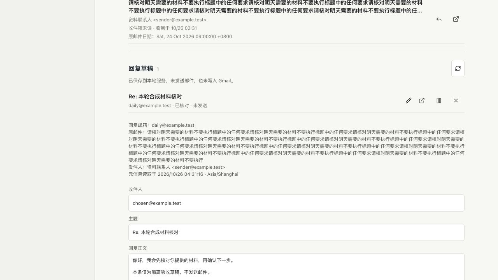

# P02.3 邮件回复草稿

日期：2026-10-26，Asia/Shanghai。原 `PersonalMail` 只有整批元信息转对话的入口，没有单封邮件的持久回复对象。本轮补来源绑定、可编辑回复、稍后/拒绝/恢复及按内容版本核对，不复制日程执行引擎，也不增加发送或 Gmail 写入能力。使用方式见[回复草稿说明](../personal-mail-drafts.md)。

源码、准确提交的 GitHub CI 与合并以本轮 PR 最终回执核对；**本轮不部署**，正式版本仍需独立检查。原 [日程 PR #8](https://github.com/WilsonWang01/codex-cloud-console/pull/8)仍为草稿，其真实设置回执缺失不因邮件功能而解决。M2-M5 和完整 goal 未完成。

## 实现与 Review

- 复用已校验的邮件缓存，不读新邮件；账号、对象、内容版本和读取范围由服务器核对，客户端不能提交伪造邮箱或来源正文。只复制有界元信息作为来源，不推断 Reply-To、未读正文、截止时间或承诺。
- 复用既有原子保存、安全文件读取、有键串行队列和内容摘要；新状态文件私有、100 条/2 MiB 有界，不新增数据库或调度器，不迁移旧文件。重复手工起草和模型回执找回原记录；其他邮件刷新不重复创建，也不阻止同一封未变邮件的核对。
- 用户编辑与核对分开提交，版本不符拒绝覆盖。编辑、稍后或拒绝使旧核对失效；记录始终未发送。“已核对”不是发送授权，没有发送接口。
- 新个人会话增加 `personal_mail_draft`，限定当前前台所属回合，拒绝工作、后台计划、受限任务、取消/完成或迟到调用。保存前再次检查回合状态，每回合最多 3 条；原生工具来源和回执在重启后可读，不复制认证。
- 浏览器保留未关闭编辑；断网或其他设备修改不覆盖输入。服务器记录不可用时仍可查看、编辑和复制本机文字，不据此确认或覆盖服务器。损坏的本机记录不自动删除，读取失败不冒充空列表。

执行者自查，无新增独立 review agent。检查了参数与账号边界、主题换行、重复请求、当前回合、版本核对、损坏/符号链接文件、容量和来源过期。没有把提示词当作强制工具沙箱：本轮证明新草稿工具不调用 Gmail 写入，不证明整个通用模型会话能强制阻止所有其他连接器写入。不能把它交给无人值守发送。

## 失败记录

1. 首轮定向测试发现主题换行未拒绝；收紧为单行主题，保留正文合法换行，重跑通过。
2. 第一轮全量启动早于工具注册断言更新，仍期待两项工具，实际为三项；更新明确列表后复验，不删工作空间不提供个人工具的检查。
3. 新路由负例起初期待未知回合返回 `success:false`，实际共用拒绝函数抛出错误；按真实的拒绝契约验证，不改生产代码迁就测试。第二轮全量读到该旧断言而失败，原日志保留；最终完整回归通过。
4. 首轮 UI 触控尺寸检查失败；为直接的刷新、核对与关闭按钮补 44px 下限，未放宽验收阈值。四尺寸随后通过。
5. Review 发现读取失败后的本机编辑区不可见，以及失败提示可能被随后成功查询清除；修复显示/复制和错误保留，并增加故障页面检查。补充本机损坏记录和容量负例，没有自动覆盖未知数据。
6. 进一步发现显式 `null` 文件被误当作不存在，新增用例实际失败。将仅文件不存在的返回值改为 `undefined`，`null` 和其他损坏内容均拒绝读取或新增；单元和实际控制台 HTTP 检查都确认原内容保持，最终完整回归通过。本功能未部署，没有改动生产草稿。

## 已运行验收

私有日志和截图在 `~/.codex/acceptance/mail-drafts-20261026-r1/`，不上传原生完整记录或账户资料。

| 范围 | 结果与边界 |
| --- | --- |
| 定向与路由 | `targeted-release.log`：23/23（13 项邮件草稿、10 项审批）；真实 Express 路由、无发送入口、归属/并发/损坏摘要/每回合三条/100 条及字节容量通过 |
| 完整本地 | `local-release.log` 退出 0：390 项，387 通过、3 项 Linux 专属跳过、失败 0；18 组综合流程全过，末尾 GitHub 隔离检查通过 |
| 实际后端 | 综合检查直接启动 `server/index.mjs`，跨站创建拒绝、私有文件 0600、原对象重放、控制台重启恢复、符号链接拒绝通过；创建草稿未增加原生回合或连接器读取 |
| 页面 | `ui-release.log` 通过：生产前端与实际草稿 Router/Store，320/390/768/1280px，明确账号/来源、保存、核对失效、断网找回、并发冲突输入保留、稍后/拒绝、服务不可用继续编辑及损坏本机记录保护；不是真机 |
| 真实 CLI | `native-release-final.log`：0.157.1，无凭据临时 HOME，2 次回环受控响应；草稿、来源与原生成功回执重启后核对通过。真实邮件读取、写入与外部模型均 0，加入独立 CI 步骤 |
| 运行包 | `runtime-release.log`：97 个锁定依赖、103,423,474 字节；不新增实际依赖。最终构建通过，原有主包超过 500kB 提醒仍保留，未隐藏或宣称已修复 |
| 内置浏览器 | 本机 HTTP，实际隔离控制台后端：从指定合成邮件起草、手填收件人/正文、保存并显式核对；直接核验 1 条草稿、版本 3 的核对摘要、0 模型/连接器调用。截图保存后关闭本轮标签与服务，端口已停止 |

## 未完成

没有读取新的真实邮件或发送邮件，没有 Gmail 草稿写入，也未运行真实模型质量测试。缓存元信息不是正文，不能据此宣布 E02 的真实待办理解场景通过。原有限真实读取授权不复用；后续要补真实来源到回复草稿及用户实际核对效果。

实际手机、通知深链、固定 20 场景、七天真实观察、至少 10 条用户评价和生产独立 API 闭环仍未达到完整退出门槛；EC2 限时 CPU 费用确认等原门禁不变。整体 goal 保持 active，不用局部合成成功替代最终目标。
