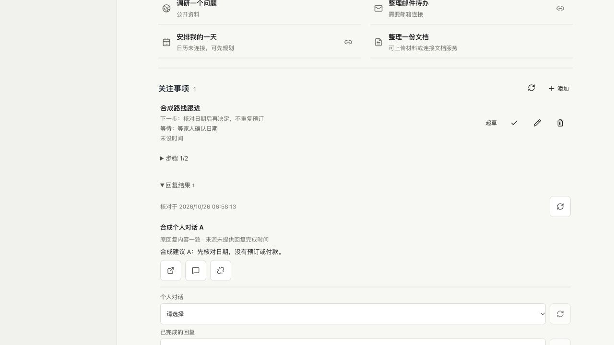

# 个人事项的具体回复结果关联验收

本轮补 P03/E16 的“关联原任务结果”缺口：原来只关联整段个人对话，现在能选择一条已完成的具体助手回复，并在继续前重新核对来源。复用既有事项文件、原生线程读取和未发送草稿入口，不建立第二套目标或执行引擎。源码交付和准确提交的 GitHub 检查见本轮 PR 回执；未部署 EC2。

## 怎么用

1. 进入“个人 → 今日”，在一项关注事项中展开“回复结果”。默认收起时不读取原生历史。
2. 选择个人对话，点击旁边的刷新图标读取，选择具体回复，再点击加号关联。每项最多 8 条，只列最近 20 条已完成最终回复；过程记录、未完成回合和工作对话不能关联。
3. 已有关联可查看原对话，或点击“基于此结果起草下一步”。后者重新核对原文后建立未发送的个人草稿，用户补充要求后自行决定是否发送；不会自动运行模型或执行外部动作。
4. 移除只解除关联，不删除原对话、原回复或草稿。来源改变、不可读取、事项版本冲突时保留记录，明确提示，不自动重试保存或继续。

关联文件只保存本地对话、原生线程、回合、消息编号和全文 SHA-256（内容指纹），不保存第二份回复正文。用户主动起草下一步时，才将核对后的最多 4,000 字符写入新草稿；截断明确说明。原回复不当作新指令、当前事实、外部成功回执或发送/日程/费用授权。新草稿不会自动变更目标状态、完成步骤或关联到既有目标，仍由用户核对。

## Review 与修复

| 发现 | 影响与最小修复 | 复验 |
| --- | --- | --- |
| 来源验证与显示选择不一致 | 同编号过程记录可能混入显示；统一“最后一条最终回复”的选择规则 | 首轮断言失败后修复，正文与完整指纹一致 |
| 版本冲突被新路由误报 503 | 用户不能区分并发修改与暂时故障；给共用事项错误添加明确分类 | 实际隔离 HTTP 并发从 200/503 修为 200/409，原文件不覆盖 |
| 读取期间个人归属或事项版本变化 | 不能把重复绑定或旧读取当作新核对成功；异步读取后重查归属及版本，持久保存前再次确认 | 归属变化、版本变化、重复绑定竞态均拒绝，不返回旧正文 |
| 上游明确返回部分内容 | 不能用摘要或未加载内容完成验证；按本仓库固定协议拒绝非完整 `itemsView` | `summary`、`notLoaded`、未知值拒绝，`full` 通过；兼容旧协议未带字段 |
| 回复时间来源不可靠 | 线程更新时间不能冒充回复完成时间；只使用原回合完成时间，缺失明确说明 | 日期缺失为 null，页面显示“来源未提供回复完成时间” |
| 继续前读取失败或页面切换 | 不能用旧正文建立新草稿，不能向工作空间写入迟到结果 | 清除旧正文；503/内容变化/切换工作均不创建草稿，成功操作只建 1 份 |
| 旧进度 UI 夹具期待错误的跨空间返回 | 当前服务器已经拒绝为 404，旧夹具仍要求 200 空历史 | 干净主线物理复制依赖后复现同一失败；改为更严格断言 404、无消息和会话，再通过 |

来源检查抽到一个纯模块，评价和结果关联共用；评价已有错误编号保留。结果路由单独组织，主服务器只接入依赖；没有新增依赖、数据库、模型工具、系统权限或自动第三方动作。

## 验收证据

本地最终 397 项，394 通过，3 项 Linux 专属跳过，18 组综合流程通过；准确提交的 Linux CI 以本轮交付回执为准。以下不将模拟上游当作真实模型或业务验证。

| 检查 | 实际结果与边界 |
| --- | --- |
| 完整本地回归 | 397 项，394 通过、3 项 Linux 专属跳过，18 组综合流程通过；跳过不算通过 |
| 定向后端 | 13/13：旧格式、未知字段、完整指纹、上限、损坏保护、并发/归属/版本变化、实际 HTTP、重启及移除通过 |
| 共用来源定向复验 | 评价 + 新来源/HTTP 共 20/20；原评价接口、错误分类及新部分回复保护通过 |
| 新结果页面 | 实际隔离控制台 + 模拟 CLI；1280/768/390/320 四宽度、44px 操作区、无横溢；错误保存回执不误报成功、不自动重试，保留所选输入 |
| 相关进度与评价页面 | 旧进度和回复评价流程通过；包括冲突、输入保留、导航/重启、迟到响应与五种视口的既有断言 |
| 内置浏览器 | 最终页面亲自展开原回复，再点击起草，准确来源进入 1 份未发送草稿；0 条原生消息、无原生线程，原 `gpt-6-astra / ultra` 和未发送草稿保持 |
| 运行包 | 97 个锁定依赖，macOS 103,423,474 字节；独立安装/加载、依赖版本与锁文件核对通过 |
| 无副作用 | 本轮真实模型、邮件/日历读写、生产测试数据和 AWS 变更均为 0；只读版本查询仍为生产 `70b191f` |

截图只有本轮隔离虚构数据，不是生产用户结果。最终内置浏览器临时标签及仅监听本机的测试服务已关闭，没有新增常驻服务。

保留的失败记录包括：最初正文选择/截断断言、CAS 错误分类、旧进度夹具启动失败。首次用符号链接依赖复制基线时被原 PDF 文件权限探针拒绝，因此那次不算有效基线；物理复制依赖后的同错误复现才作为依据，没有放宽沙箱。构建仍有主包超过 500KB 的既有警告，本轮没有假装消除。

私有原始日志、实际浏览器截图、最终草稿/模型保留核对和旧夹具基线保存在 `~/.codex/acceptance/result-references-20261026-r1/`。此前授权的共享 CLI 测试信任项清理早已完成；本轮没有再恢复旧配置或复制登录凭据。

## 未完成

这不是 E16 的真实跨日模型质量验收，也不是通用业务回执：绑定的是助手文字，不证明订票、邮件或日历动作成功。当前只支持文本最终回复；图片、工具产物和具体第三方动作仍沿用各自原有回执，不冒充本轮已统一。

EC2 未更新，本机正式代理未切换。生产验收仍受已单独询问的 CPU 费用前置条件和专用 API 测试配置约束；不绕过确认。真实邮件读取、日历新测试、实体手机、七天观察及至少 10 个真实用户评价等原门槛继续保留。整个 goal 保持 active，不宣称与竞品全面对等。
