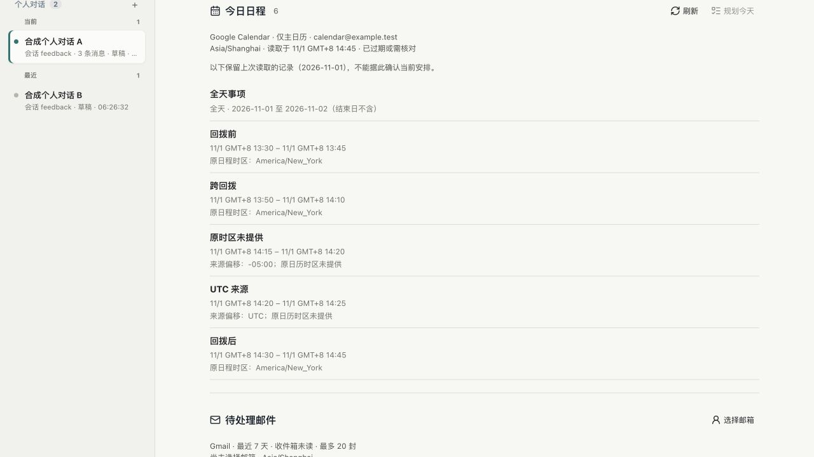

# E05 日程时区与夏令时展示

本轮只补原 20 场景中 E05 的展示缺口，基线为 main `8437a45`。不扩展日历权限或动作能力，也不把此检查当成提案、真实日历回执、真机或完整 E05 已验收。

## 复现与实现

纽约 2026-11-01 回拨时，一条有效日程从 `01:50-04:00` 开始、在 `01:10-05:00` 结束，实际经过 20 分钟。旧页面省略偏移，显示 `01:50–01:10`；回拨前后的两个 `01:30` 也无法区分。切换设备为上海时区后，来源标题写上海，旧缓存行内仍显示纽约时间，且不再注明纽约来源。

新增实际控制台后端、拒绝推理和连接器的合成夹具，两个时区、四种宽度的 8 个负例均失败并保留原日志。最初的浏览器默认路径未安装，以及测试把正常补齐的 `updatedAt:null` 当成草稿损坏，属于验收脚本问题；修正为项目既有 Chrome 通道、逐项核对原草稿字段后才获得上述产品负例，没有据此改产品逻辑。

产品只改两行：共用时间格式加 `timeZoneName: "shortOffset"`；所有日程行与来源标题统一使用设备时区，原时区与设备不同时仍注明。沿用 [ECMA-402 的时间格式字段](https://tc39.es/ecma402/2025/#table-datetimeformat-components)，不手写偏移算法或增加依赖。

全天日期继续原样显示，明确结束日不含；没有原时区时保留来源的 UTC/偏移，不推断不存在的时区。原快照、版本、存储、模型和权限均不改；过期缓存仍不能用于“规划今天”。

## Review 与验收

执行者检查了共用 `stamp` 的开始、结束和读取时间调用点、`itemTime`、来源时区标注、过期判断和后台时间验证。后台已有夏令时 23/25 小时窗口及真实时刻排序，无需重复实现。没有另开独立 review agent。

| 范围 | 实际结果 |
| --- | --- |
| 定向单元 | 日历与实时来源有效性 15/15，包含 23/25 小时窗口、起止顺序、全天日期与来源校验 |
| 新日历 UI | 纽约/上海 × 320/390/768/1280px 共 8 组通过；重复小时标识不同、跨回拨时刻明确、上海显示 13:50–14:10；全天、未知原时区、UTC、原顺序、过期禁用、44px 操作区、无横溢和零页面异常均检查 |
| 保留检查 | 日历文件逐字节不变；原会话草稿的每个既存字段保留；模型回合、命令和连接器数据调用 0 |
| 完整本地 | `verify-local.log` 退出 0：400 项，397 通过、3 项 Linux 专属跳过；18 组 HTTP，最后 GitHub 隔离流程通过 |
| 既有个人 UI | `personal-ui-r2.log` 退出 0，包含七种宽度、日历刷新/过期/失败/部分来源、草稿和模型设置竞争等原断言；首次默认 5174 无服务导致连接拒绝，启动仅提供 dist 的 127.0.0.1 静态服务后复验，没有放宽断言 |
| 内置浏览器 | 同机实际后端 HTTP 200、127.0.0.1:64590；上海时间、纽约来源、全天/UTC/未知来源和过期警告可见。切换个人对话确认原草稿，再返回及刷新，日程一致；共 48 条模拟协议请求，真实模型及连接器数据调用均 0 |

夹具是 2026-11-01 的合成纽约记录，后端没有改时钟；当前日期/设备时区不同使缓存过期，不能据此判断今天安排。自动化只固定浏览器时钟来检查时间格式，不冒充跨日或七天观察。实际浏览器没有改设备时区，纽约设备由自动化上下文覆盖。

所有临时页面与两个预览服务已关闭。原用户标签页、主目录并行代码、可靠性分支与共享 CLI 配置保留；受保护代码及配置 SHA 与开始一致。原始负例、最终 8 组截图、实际页面和完整日志在私有 `~/.codex/acceptance/calendar-timezone-20261027-r1/`。新增 `npm run verify:calendar:ui` 并纳入 CI；最终 Linux 与准确 head 的结果以 PR 回执为准，不把本机跳过当作 Linux 通过。

## 未完成边界

尚未部署，正式本机/EC2 仍为 `98a1b4f`；本轮未连接 EC2、创建令牌或执行生产模型。原取消候选的 Linux 失败门禁及费用确认、替代测试令牌确认仍保留，不借此发布整个 main。

E05 的真实日程提案与写入回执仍随 PR #8 待具体确认；生产独立客户端、真实邮件到草稿、E16 跨日、实体手机、七天观察及实际用户评价仍未退出。本轮不为 20 场景整体计分，完整 goal 保持 active。
