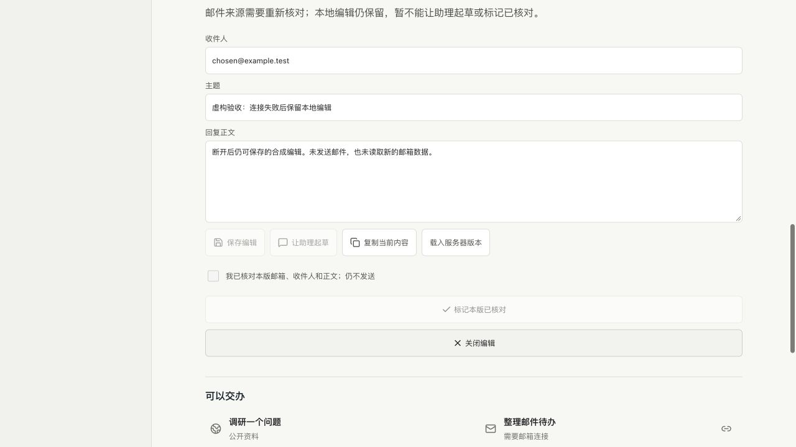

# E08 邮箱来源失效与草稿保留

本轮从原方案 20 个固定场景的证据核对中，先复现并修复 E08 的一个明确缺口，不扩大成新功能。基线为主线 `4cb337a`；不修改原场景或 18/20、关键场景全通过、真机、七天及用户评价门槛。其他场景没有因为本轮检查而自动计为通过。

## 复现

- 已缓存一份仍在五分钟有效期内的虚构邮件来源，账号目录随后不再包含该账号。修前 `source.accounts()` 仍让旧快照保持 `stale=false`；新增断言实际得到 `false !== true`。
- 页面列出剩余账号后取消选择，旧来源的“整理待办”和“起草回复”又可点击；新增浏览器断言实际得到 `true !== false`。没有真的撤销用户连接或读取邮箱。
- 修复这些入口后，继续核对调用方，发现旧回复草稿内的“让助理起草”仍是独立入口。第二条 UI 负例再次实际失败，随后一起接到共用来源核对结果，不只修上方按钮。

## 最小实现与保留边界

账号目录成功返回时，按连接标识与邮箱地址一起核对缓存归属；原账号缺失或身份变化就持久标记需核对，目录读取失败也不能通过刷新恢复成新鲜来源。保留原快照内容、版本、读取时间和所有草稿，不换用其他邮箱，不自动读取消息。重新列出健康账号不会清除失败，需明确刷新邮件。

沿用来源文件的 version 1，只在失败记录增加可选的目录操作标识和之前邮件请求时间。原有邮件请求冷却保留，目录核对本身也不会让用户多等一个新的邮件冷却周期；旧读取器仍能将该记录识别为错误状态。写入失败不伪称列举成功、不盲目重试或替换损坏文件，没有新增存储或队列。

页面和草稿编辑区复用一个来源解析函数：核对当前账号、邮件 ID、条目版本、时区和实时失效边界，并使用当前快照编号。来源失效时阻止新起草、模型草稿入口与再次核对；已有编辑、保存、复制、稍后和拒绝操作仍可用。失效会清除待提交的核对勾选；点击时仍复核，服务端对直接调用保持同样拒绝。没有发送邮件或 Gmail 写入入口。

执行者自查覆盖来源存储全部调用方、原始邮件请求冷却、账号身份变更、目录失败/恢复、字段校验、存储失败、重新启动及前端所有来源消费者。没有独立 review agent。只修改既有来源模块、两个相关组件、对应测试和 CI；不新增依赖、权限、执行器、定时器或模型设置。

## 验收

| 范围 | 实际结果 |
| --- | --- |
| 定向单元 | 28/28，覆盖账号缺失/身份变更/目录失败、快照保留、重启、仅重连目录不恢复新鲜度、原冷却、无效标识与写入失败；同时保留原邮件草稿检查 |
| 实际隔离 HTTP | 定向组通过，2,667ms；模拟上游移除账号后缓存失效，重启不恢复。旧草稿可编辑，但直接提交 ready 返回 409/mail_draft_source_changed、原编辑不变；没有模型或其他邮箱读取 |
| 最终完整本地 | `verify-local-r2.log` 退出 0：400 项，397 通过、3 项 Linux 专属跳过、失败 0；18 组 HTTP scope=all，最后 GitHub 隔离流程通过 |
| 最终邮件 UI | `final-ui-r4.log` 退出 0；账号缺失和同 ID 邮箱变化的取消路径、已保存草稿入口、原迟到响应/过期/离线/并发/拒绝保护通过；320/390/768/1280px 的错误状态无横溢、按钮至少 44px |
| 模型工具质量模拟 | 3 类合成输入通过，真实模型、真实邮件、第三方写入均 0；不把它当作新增真实模型质量证据 |
| 内置浏览器 | 同机 HTTP 200、仅监听 127.0.0.1 的实际应用后端加拒绝推理/连接器的模拟 CLI；目录读取失败发生在自然过期前，刷新后仍阻止待办、起草和核对。原本地草稿改文后保存并刷新，编号及正文保留；原快照逐项不变 |

实际页面的目录失败代码为 `mail_read_failed`，不是实际撤销 Gmail；账号移除由前述真实后端 HTTP 加模拟目录覆盖。最终模拟 CLI 共 101 条协议交互，模型回合和连接器数据调用均 0。浏览器首次检查用错了本工具不支持的 inputValue，在已保存和刷新之后中止；改用只读 DOM 核对，没有重复保存。保留失败日志及三组负例，不把重跑结果改写成首次通过。

已将既有邮件 UI 全流程加入 CI，避免只在本机检查这条关键保护。GitHub 最终验收须核对对应 PR 的准确 head；本文本地三个 Linux 跳过不算 Linux 已验证。原始日志/截图在本机私有 `~/.codex/acceptance/personal-source-revocation-20261027-r1/`。

## 未完成与发布

本项尚未部署；正式本机/EC2 仍为 `98a1b4f`。必须成对发布前后端，不能把只更新页面当作持久失效保护已上线。费用复验、替代测试令牌等具体确认仍待答，不绕过取消候选的 Linux 失败门禁，不运行生产模型或操作真实邮箱/日历。

完整 20 场景的退出证据仍须逐项核对：尤其 E02 的新鲜真实邮件到草稿、PR #8 的具体确认与真实日程回执、E16 的原一次跨日延续、E19/E20 真机和七天/十条实际用户评价。本轮只补 E08 的已知来源失效缺口，不据此宣布整体个人助理、M2-M5 或竞品全面对等。
