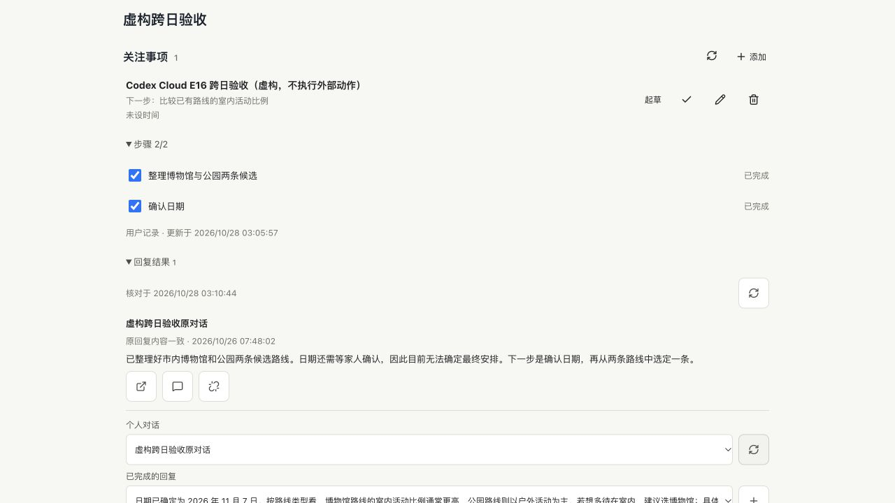

# E16 真实跨日样例：归档恢复与只读复核

本轮完成原验收专用会话的一条真实跨日延续样例，不重做准备、不改时间、不用新会话代替原历史。固定产品源码为 `ea679f4`；报告提交不表示最新 main 或 EC2 的完整流程已验收，也不直接为原 20 场景整体计分。

## 授权与原记录

用户明确允许只恢复这一条已归档的虚构测试会话，再做一次最多 120 秒、一个模型回合的续接。不恢复其他归档会话，不读取真实邮件，不改日历或其他第三方数据。原生目标自动续做的恢复接口仍遇原任务会话占用，本次定向验收不等于原 goal 已恢复；没有新建替代 goal 或清空累计记录。

准备阶段在北京时间 **10 月 26 日 07:48:02.684** 完成：一次 `gpt-6-sol / medium` 回合、11,591 tokens，保存原回复及事项关联。冻结脚本、原检查点、原线程和私有事项持续保留。到本次完成已过 **43.30 小时**，未调整系统时钟或重新生成准备时间。

先前续接在模型启动前因会话已归档失败，实际模型 0 回合。其失败 JSON 和 `resume-started.json` 保留，未删除标记后重跑；取得本次具体批准后，通过原生接口只取消该测试会话的归档，并校验恢复后的历史文件字节与备份相同。

## 本次结果与误判

| 项目 | 实际结果 |
| --- | --- |
| 限时模型 | 原线程 `gpt-6-sol / medium` 一次，输入 12,176、输出 74、合计 **12,250 tokens**；原两阶段样例累计两回合、23,841 tokens |
| 回答 | 使用已确认的 2026 年 11 月 7 日，比较博物馆和公园的室内活动比例；不继续等待家人确认日期，不重新整理候选，不声称预订或付款成功 |
| 原始运行回执 | `ok:false`：原日期正则不接受中文日期间的空格。原回答实际为“日期已确定为 2026 年 11 月 7 日”，不是日期错误；原失败未改写 |
| 离线补核 | 放行日期内空白，正确日期的三种格式通过，错误年/月/日及多余数字拒绝；只对同一份已保存回答复核，没有再调用模型 |
| 停止后原生读回 | 结束本轮 CLI 后，新进程只读原线程：旧回复和新回合的完整正文均逐字相同，新回合状态 completed；不是从报告文件冒充原生存储 |
| 事项状态 | 原私有事项保持 active，步骤 2/2、旧等待原因清除、下一步为比较室内比例，原精确结果关联保留；测试进度本轮确实更新，修改前备份保留，不能称事项全文未变 |
| 原始保护 | 原生历史旧前缀、冻结 probe/checkpoint、原失败/一次性标记保持；共享配置与主目录受保护代码 SHA 均未变化 |

派生恢复脚本的模型调用及核心校验函数与冻结原脚本逐字一致；只新增恢复入口、原失败/线程身份/内容指纹核对和独立输出路径。旧失败必须是归档错误且模型数为 0；新阶段也只创建一次，缺少批准标识在启动记录及模型之前拒绝。执行者完成差异 review 和负例检查，没有独立 review agent。没有新增产品依赖、权限或运行时代码。

## 实际页面

复用未修改的事项组件、现有结果路由和真实原生回复，服务仅监听 `127.0.0.1`。1280/768/390/320 四宽度通过：两个步骤已完成，新下一步可见、旧等待原因不再显示在当前事项中，旧关联仍展示明确的原日期。44px 操作区、无横溢、无页面异常；UI 检查前后事项字节相同，页面阶段模型和写入均 0。

内置浏览器实际展开步骤与原结果，再只读列举同一原会话的回复：可同时看到 10 月 26 日原回复和本次确认日期后的新回复；只选择查看，未点击“关联”来替换原结果。以下是隔离组件页面，不是完整应用导航或实体手机。

HTTP 页面 200，写入入口 405，页面允许目录外的配置文件请求 403；没有扩大文件白名单或公开监听。最终预览只记录 3 次原生读取，无工具/模型请求，退出 0；本轮标签页和临时端口已关闭。

## 证据与未完成

原准备、首个归档失败、冻结脚本均留在本机私有 `~/.codex/acceptance/personal-crossday-20261026-r1/`；本轮备份、原始失败、离线验证、四宽度及内置浏览器证据位于其 `recovery-20261028-r2/`。不能将原始失败 JSON 改成成功，不能再执行已消耗的恢复脚本来重复推理。

本轮没有部署 EC2 或调用生产 API，没有邮件、日历、订票等业务写入或额度重置。真实日常场景完整验收、生产独立客户端/回调、真机、七天观察和至少十条实际用户评价仍未完成；原目标恢复及生产令牌/费用复验等具体门槛继续保留。此样例推进了真实跨日质量证据，不代表 M4/M5 或竞品全面对等。
