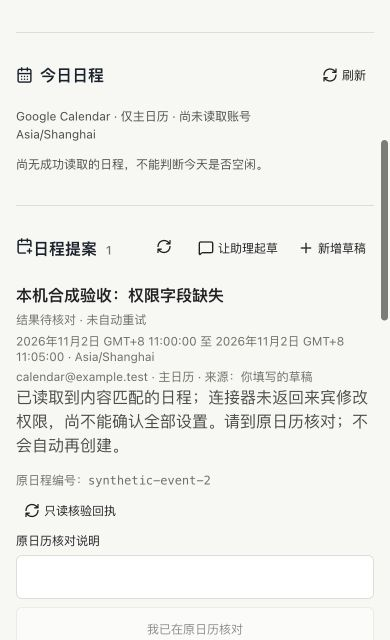

# 日程完整详情回执与主线整合

## 范围和现状

本轮从 main `308cc86` 整合原日程候选 PR #8 的冻结头 `6020e4b`，只处理日程提案的完整详情回执及必要的主线兼容。保留当前邮件正文、回复草稿、记忆引用、回合归属、取消、用量和运行恢复保护，不以旧候选覆盖新主线。

尚未合并或部署。本轮没有新建真实日程、调用真实模型、变更本机/EC2 安全设置或重启生产服务；原数据和任务不动。准确候选和 CI 结果在 PR 交付回执核对，不能用此前 PR 的通过结果代替。

## 复现与修复

- 只读核对原授权测试留下的 EC2 回执及清理记录：当时 `create_event` 和 `fetch` 没有提供完整忙闲/来宾修改权限。原测试已创建并清理各一条，没有复用一次性许可重建。
- 当前官方 `read_event` 对同一条已清理测试编号返回 `cancelled` 和明确的 `opaque`，仍未提供来宾修改权限。这证明摘要投影少字段，但不证明新的已确认日程能完整验收；取消记录绝不能算成功。
- 新回归先复现旧实现：15 项中 7 项失败。将摘要投影明确模拟为缺字段后，旧业务读取无法得到成功回执；缺少完整详情工具也未被旧实现拒绝。
- 改用 `read_event`，创建前核对其账号、参数和只读声明，重核对也不回退到 `fetch`。仍要求真实返回忙闲、来宾修改权限、私密、提醒、参与者、重复及会议设置；任何缺失保持待核对，不猜测默认值，不重新创建。
- 旧待核对记录可在同一账号用升级后的完整工具只读核对；创建仍绑定原工具合同和具体确认，不允许借工具升级切换账号或重新执行。
- 新完整详情回执明确记录来源 `google_calendar.read_event`，按需写格式 3；旧格式 1/2 的 `fetch` 回执只读保持原样。格式 3 不会因后来保存模型草稿降回 2，旧版本不能读新格式时阻止自动回退，原文件不改写。

## Review 和验收

- 定向 43 项通过、0 失败/跳过：账号与工具声明、一次执行、重复确认、丢失回执、取消记录、缺字段、旧记录升级核对、账号变更拒绝、格式兼容和回退保护，以及审批/个人执行器。
- 现有隔离实际后端 UI：1280/768/390/320 四宽度编辑、冲突另行确认、刷新保留、来源对话往返及拒绝通过；合成连接器，不是真实日历成功证明。
- 内置浏览器实际点击：未勾选不能创建、勾选后单次合成执行、完整回执展示；来宾权限缺失保持“结果待核对”，只读复核和刷新不再创建。390px 无横向溢出。日期控件的内置浏览器自动填值未生效，因此该次手工流程从隔离 HTTP 草稿开始；四宽度自动化另行实际覆盖日期表单，不将两者混称。
- 原生 CLI 0.157.1 的邮件和日程工具分别完成合成响应往返、原线程历史和进程重启读取，真实模型/邮件/日历调用为 0。0.165.0 仅生成静态协议确认兼容字段，不冒充实际日历动作验收。
- 独立运行包通过，111 个锁定包可加载，包含日程模块，构建依赖不混入运行包。
- 整套回归第一次在构建时发现可选版本字段的 TypeScript 检查失败，已修复；第二次在既有 250ms 限流窗口断言出现 200/429 不一致。检查生产限流代码无本轮改动，只将该隔离检查的窗口和对应过期等待改为同一 5 秒常量，保留原断言，不修改生产限流。完整复验与准确 CI 以交付回执为准，失败记录保留。
- CI 保留当前 CLI Linux 命令边界、取消/中断、材料、MCP 及所有原门禁，增加日程四宽度和模型提案 UI；bwrap 配置仍只允许 GitHub 临时主机使用。

## 发布前尚缺

仍需新的具体许可，才可在指定真实账号的主日历做一次无邀请/提醒/Meet 的创建、读回与清理。原许可已消费，本轮请求尚未收到答复；仅旧取消事件的只读结果不能放行发布。即使获准，若仍缺字段或超时，保留待核对和记录，不重建、不冒充通过。

本项不完成 M2 的真实图片输出、M3 的公网回调/生产 MCP、个人 20 场景 18 成功、真机、七天观察或用户有用率；原 goal 继续 active，完整退出标准不缩减。
