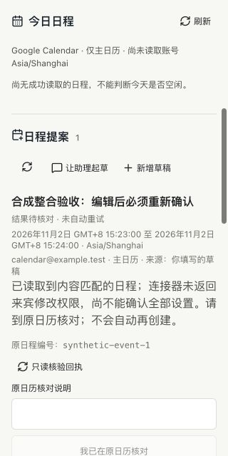

# 日程完整详情回执与主线整合

## 当前主线接续

2026-10-31 将候选 `027bc18` 接回 main `5fb0323`。M3 的生产 MCP 与公网回调仍缺具体确认/目标，本轮只推进原 M4/P02 的必要兼容，不以新增可选功能替代原门槛。仍为草稿 PR #52，未合并到 main 或部署。

三份计划文档的冲突保留两边时间线；程序自动合并后逐项核对，保留当前会话列表不再隐式裁剪、个人事实应用内删除确认、工作/个人输入区及侧栏保护、回调配置非阻塞读取和对应回归。没有覆盖另两个工作树或删旧数据。

另补两个本轮实际发现的缺口：

- 原生日程检查硬编码 CLI 0.157.1。复用既有显式版本变量，严格匹配已核实的 0.157.1/0.165.0，其他版本和错误二进制在创建临时状态前拒绝；报告输出实际版本，不更改用户全局 CLI。CI 保留旧版步骤，新增固定 0.165.0 的真实动态工具/持久化/重启读回检查。两版均用无账号私有 HOME、本机合成响应，真实模型和日历写入为 0。官方将 App Server 动态工具标为实验接口，不能只凭新版文档或静态 schema 推定旧/新版本可用，见[官方说明](https://learn.chatgpt.com/docs/app-server)。
- 320px 实际内置浏览器中，标题被工具栏挤成两行（约 40.53px）。仅把日程提案加入已有标题栏换行规则，修复后为约 21.02px、单行且无横向溢出。回归最初把行高当成含计数小字的整体高度，在桌面误报；改成桌面单行实际高度基准，空/非空场景都检查，旧 CSS 在 320px 真实失败，修复后通过。原始失败与中间检查保留，不通过改字号或放松溢出保护掩盖问题。

### 本轮验收

私有原始证据：`~/.codex/visualizations/2026/07/05/019f3358-e9db-7380-9029-3daa3597a55d/acceptance/calendar-main-sync-20261031-r1/`。

| 检查 | 实际结果与边界 |
| --- | --- |
| 定向动作/提案/审批/个人运行时 | 43/43，0 失败/跳过 |
| 完整本地 | 整合及版本门禁后的 `verify-local.log` 退出 0；435 项，432 通过、3 Linux 专属跳过、0 失败；21 组 HTTP、GitHub API 集成通过。随后只改上述 CSS 与 UI 检查，最终构建和相关页面另验；不将前一轮整套写成后改动的准确 CI |
| 实际 CLI | `native-0157.log`、`native-0165.log`：各一次动态日程工具、本地草稿/来源持久化与进程重启读回，均为 2 次合成提供方请求、0 外部模型/日历写入；`cli-guards.json` 的 3 种错误版本组合全部提前拒绝、无临时状态创建 |
| 最终页面自动化 | `actions-ui-final.log`、`model-ui-final.log`：四宽度编辑/确认/冲突/缺字段/旧输入/来源对话与重载通过；聊天提案回合为替身，3 次创建仅在隔离连接器内；新增标题断言覆盖空及非空待核对状态 |
| 已交付保护 | `reading-ui-final.log`、`facts-ui-final.log`：原阅读/离线草稿/9 个个人和 7 个工作视口、事实删除取消/Escape/冲突及输入保持通过；不算实体手机 |
| 实际内置浏览器 | 1280、390、320px；真正填写表单、具体勾选后编辑使旧确认失效；再确认后缺来宾字段保持待核对，原编号、只读复核、刷新不重建。日期 `fill` 未驱动表单状态，改用原生选择器/方向键实际填入后保存，没有通过后台创建草稿代替表单验收 |
| 页面后独立核对 | `browser-state-summary.json` 与保留的 RPC/状态快照：224 条 RPC 中无 `turn/start` 或登录启动，1 条合成创建、2 次合成详情读取、原 `synthetic-event-1`；提案仍待核对、receipt=null，不伪装成功 |
| 运行包 | `runtime-package.log`：111 个锁定包、105,615,746 字节，已有运行/回退保护检查通过 |
| 清理 | 仅 `127.0.0.1:60778` 隔离服务；打开前及重建后 HTTP 200。截图后关闭自建标签、重置视口、停止本轮进程，端口无监听；原生产代理/EC2 未操作 |

本轮无新增 review agent，由执行者自查合并差异、唯一账号/工具合同、修改使旧确认失效、一次持久领取、缺回执不重放，以及当前主线保护。准确最终头、CI 和 PR 状态见交付回执，不复用旧候选 `027bc18` 的 433 项结果。

本轮没有真实 Google Calendar 创建/删除、邮箱读取、生产令牌、模型消费、权限扩大或部署。先前询问的单次真实日程许可仍未答复，不能改日期、复用旧许可或以页面合成成功放行发布。M3-M5、固定 20 场景/真机/七天/真人评价与完整 goal 保持。

## 范围和现状

本轮从 main `308cc86` 整合原日程候选 PR #8 的冻结头 `6020e4b`，只处理日程提案的完整详情回执及必要的主线兼容。保留当前邮件正文、回复草稿、记忆引用、回合归属、取消、用量和运行恢复保护，不以旧候选覆盖新主线。

尚未合并或部署。本轮没有新建真实日程、调用真实模型、变更本机/EC2 安全设置或重启生产服务；原数据和任务不动。准确候选和 CI 结果在 PR 交付回执核对，不能用此前 PR 的通过结果代替。

## 复现与修复

- 只读核对原授权测试留下的 EC2 回执及清理记录：当时 `create_event` 和 `fetch` 没有提供完整忙闲/来宾修改权限。原测试已创建并清理各一条，没有复用一次性许可重建。
- 当前官方 `read_event` 对同一条已清理测试编号返回 `cancelled` 和明确的 `opaque`，仍未提供来宾修改权限。这证明摘要投影少字段，但不证明新的已确认日程能完整验收；取消记录绝不能算成功。
- 新回归先复现旧实现：15 项中 7 项失败。将摘要投影明确模拟为缺字段后，旧业务读取无法得到成功回执；缺少完整详情工具也未被旧实现拒绝。
- 改用 `read_event`，创建前核对其账号、参数和只读声明，重核对也不回退到 `fetch`。仍要求真实返回忙闲、来宾修改权限、私密、提醒、参与者、重复及会议设置；任何缺失保持待核对，不猜测默认值，不重新创建。
- 旧待核对记录可在同一账号用升级后的完整工具只读核对；创建仍绑定原工具合同和具体确认，不允许借工具升级切换账号或重新执行。
- 新完整详情回执明确记录来源 `google_calendar.read_event`，按需写格式 3；旧格式 1/2 的 `fetch` 回执只读保持原样。格式 3 不会因后来保存模型草稿降回 2，旧版本不能读新格式时阻止自动回退，原文件不改写。

## Review 和验收

- 定向 43 项通过、0 失败/跳过：账号与工具声明、一次执行、重复确认、丢失回执、取消记录、缺字段、旧记录升级核对、账号变更拒绝、格式兼容和回退保护，以及审批/个人执行器。
- 现有隔离实际后端 UI：1280/768/390/320 四宽度编辑、冲突另行确认、刷新保留、来源对话往返及拒绝通过；合成连接器，不是真实日历成功证明。
- 内置浏览器实际点击：未勾选不能创建、勾选后单次合成执行、完整回执展示；来宾权限缺失保持“结果待核对”，只读复核和刷新不再创建。390px 无横向溢出。日期控件的内置浏览器自动填值未生效，因此该次手工流程从隔离 HTTP 草稿开始；四宽度自动化另行实际覆盖日期表单，不将两者混称。
- 原生 CLI 0.157.1 的邮件和日程工具分别完成合成响应往返、原线程历史和进程重启读取，真实模型/邮件/日历调用为 0。0.165.0 仅生成静态协议确认兼容字段，不冒充实际日历动作验收。
- 独立运行包通过，111 个锁定包可加载，包含日程模块，构建依赖不混入运行包。
- 整套回归第一次在构建时发现可选版本字段的 TypeScript 检查失败，已修复；第二次在既有 250ms 限流窗口断言出现 200/429 不一致。首次尝试延长整个混合夹具的窗口，又影响了后面的模型接口用例，第三次失败也保留。最终把原断言移入独立实际 HTTP 夹具，固定 5 秒窗口同时验证原键可重放、新键被拒绝及过期后接受；该项定向通过。混合夹具恢复原 250ms，不修改生产限流，不删弱断言。完整复验与准确 CI 以交付回执为准。
- CI 保留当前 CLI Linux 命令边界、取消/中断、材料、MCP 及所有原门禁，增加日程四宽度和模型提案 UI；bwrap 配置仍只允许 GitHub 临时主机使用。
- 第四次本地整套已通过限流/HTTP 部分，但原个人事项 API 检查只等 3 秒启动，在本机失败；同头 CI 的完整回归已通过。将该检查接到仓库已有的有界 HTTP 就绪函数，要求真实 `/api/release` 正常且启动日志齐全，单次上限 7 秒，不增加新的等待框架或修改生产启动。失败与最终复验分别保留，不将 CI 成功掩盖本地失败。

## 发布前尚缺

仍需新的具体许可，才可在指定真实账号的主日历做一次无邀请/提醒/Meet 的创建、读回与清理。原许可已消费，本轮请求尚未收到答复；仅旧取消事件的只读结果不能放行发布。即使获准，若仍缺字段或超时，保留待核对和记录，不重建、不冒充通过。

本项不完成 M2 的真实图片输出、M3 的公网回调/生产 MCP、个人 20 场景 18 成功、真机、七天观察或用户有用率；原 goal 继续 active，完整退出标准不缩减。
