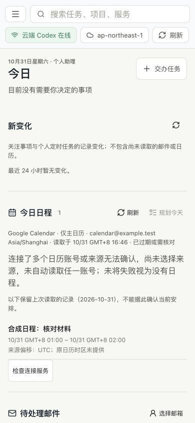

# 日历来源账号边界

## 问题与范围

本轮从原 E08/P01 的来源归属检查推进。基线 main `e3b9726`，上轮手机设置 PR #58 已合并，候选/主线各 409/409、28 步成功，未部署。本项不包含仍为草稿的日程动作 PR #52，不执行真实连接器或生产写入。

旧读取器核对同一日历连接的所有工具默认 `link_id`，却只查看搜索工具自己的 `link_accounts`。当搜索工具仍声明一个默认账号，而同一连接的另一工具声明多个账号、空列表、不一致账号或非法列表时，旧代码仍能读取并记录成功。新增隔离负例先得到 `lastAttempt.code=null`，未按既定策略拒绝，失败日志已保留。

修复仅扩展原前置检查：同一连接的全部工具都必须有一致的默认账号，任何已声明的账号列表都只能包含该账号。兼容没有列表的旧声明；不把 Gmail 等其他连接的多账号混入检查。没有新权限、默认账号选择、接口、存储格式或执行器。

## 验收与 Review

- 日历/邮件 35 项定向通过。覆盖其他工具的多个/空/异号/非法列表；在数据调用前拒绝，原快照不变，失败持久化，重启仍需核对。恢复为一致单账号后，必须由显式刷新重新读取；不自动补读。合法同账号与无关连接的多账号继续成功。
- 实际控制台后端、原构建页面与本机 CLI 协议替身：先加载一份仍新鲜的虚构缓存，再手动刷新；得到 `calendar_account_ambiguous`，保留原来源、禁用规划并提供连接检查。四宽度 1280/768/390/320、页面刷新及实际后端重启通过；只建立一个临时来源上下文，日历数据工具与模型调用均为 0。
- 所有原草稿及显式模型、推理、权限保持，来源工作计数归零。测试最初把未规范化的夹具文件与正式页面规范化后的 `updatedAt:null` 直接比较而失败；改为先通过正式草稿接口建立基线，再严格比较全部字段，原失败日志保留，没有放松产品保护。
- 实际内置浏览器在同机 HTTP 200 后验证桌面刷新前后、390px 刷新后和返回个人对话；旧日程、需核对状态、Astra/Ultra 和原未发送草稿保持。截图只有虚构数据，不是实体手机或真实日历撤销。
- 自查只修改原读取器的账号前置判断；共用测试夹具只在专用来源上下文读取新控制字段，避免给其他 RPC 增加同步读盘或竞争。工具调用仍由原夹具拒绝，不添加第二套模拟执行器或新依赖。

完整本地已通过：411 项（408 通过、3 项 Linux 专属跳过、0 失败）、20 组集成与独立 GitHub API 检查。原日历时区页面 8 项、运行设置两空间/三宽度、9 个人+10 工作阅读恢复视口及运行包检查通过（111 包、105,615,746 字节）。准确候选/主线 CI 与最终发布状态以本轮交付回执为准；尚未结束的检查不提前写通过。

## 保留门槛

未部署、未新增模型回合，没有改本机/EC2 安全设置、原任务、正式来源或凭据。新的 EC2 受控预检费用确认仍待答复，不复用已消费授权。

本项是账号声明歧义的故障注入，不冒充真实重连或完整 E08/18场景退出。M3 生产 MCP 与自有 HTTPS 回调、M4 具体邮件/日历动作、固定 20 场景完整复验、真机、七天观察及真人评价仍按原条件完成；原生 goal 保持 active，不重置额度。

