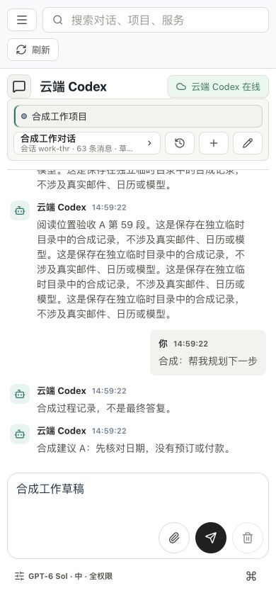

# 手机会话设置触控验收

## 范围与实现

从主线 `5fb03235` 独立修复原 P04 的手机工作底栏，未包含日程草稿 PR #52。日程候选已完成当前主线兼容与准确 CI，但仍未合并或上线，见 [PR #52 回执](https://github.com/WilsonWang01/codex-cloud-console/pull/52#issuecomment-6540825395)。本轮不重复消费真实日历、邮件、模型或生产 MCP 的一次性测试授权。

- 旧版 390×844 的指令按钮仅 `36.7×22px`，权限/模型/推理按钮均高 22px；新增回归先失败，内置浏览器独立复现。底栏两排共 54px，工作聊天区 409px。
- 沿用 `<=820px` 断点和已有会话面板；手机工作区使用一个设置摘要、一个指令图标，桌面仍直接切换权限/模型/推理。没有新设置状态、后端接口或存储格式。
- 摘要显示实际模型、推理和权限；长文本可省略，完整值保留在可访问名称及面板。个人助理继续保留保存流程入口。
- 有目标/上下文时转入同一面板，没有数据时不显示空入口；原保存、加载禁用、版本竞争及焦点规则不变。
- 新版底栏 46px，设置和指令至少 `44×44px`。390px 聊天区 417px；320×480 为 53px，比[上轮回执](2026-10-31-mobile-work-composer.md)的 45px 增加 8px，但仍拥挤，不称短屏整体体验完成。旧 320px 数值沿用已保存证据，没有回滚生产重测。

## 验收

- 构建、原阅读恢复和新增触控/子面板 Escape/焦点返回/草稿保持已通过。工作视口扩展至 320、360、390、430、768、820、821、1024、1280px 及 844×390 横屏，最终完整执行以交付回执为准；原个人九个视口与离线/刷新/阅读锚点保留。
- 运行设置检查覆盖个人/工作、320/390/1280px：加载禁用且不显示旧值、切换关闭旧面板、迟到保存不串会话、刷新保留显式模型、失败后恢复。手机权限/推理/目标/上下文可进入，单纯查看没有设置写入。
- 设置检查默认复用现有临时后端夹具，拒绝真实模型和工具；显式 `CODEX_CLOUD_UI_URL` 仍可复用指定服务。浏览器启动失败也会清理夹具。此检查加入 CI。
- 实际桌面内置浏览器验证 390px 旧版/新版、320×480、1280×800；模型/推理子面板、Shift-Tab/Tab 焦点循环、Escape 返回、刷新保留草稿。全为独立虚构会话，不是正式数据或实体手机。
- 首轮完整本地回归等待测试后端启动超时；相关首个用例独立复查通过（26,605ms 是整个用例时长，不是启动耗时）。唯一原因未确定，没有放宽超时；完整复验仍以最终结果为准。
- 新面板检查初跑没有等焦点接管，下一视口读到未关闭面板；另一检查向不可聚焦容器发 Escape 而超时。修正测试等待/按键目标，原失败日志保留，没有据此削弱产品规则。

本机最终复验已结束：409 项，406 通过、3 项 Linux 专属跳过、0 失败；20 组 HTTP/GitHub API 检查通过。原个人 9 个及工作 10 个阅读视口、三宽度/两空间设置竞争、39 项安全 UI 和运行包检查通过（111 个依赖包，105,615,746 字节）。准确头提交 CI 仍以本轮 GitHub 交付回执为准。

安全 UI 初次使用压缩的生产页面，不满足性能检查要求的 Vite 前置条件而失败；未删除原断言。随后使用本轮 `127.0.0.1` 临时 Vite 服务，HTTP 200 后按原标准完整通过。原失败、重试、截图均保留，临时服务交付前停止。

## Review

- 复用原 `activePanel` 与保存处理器，不新增依赖、菜单框架或第二套移动状态；手机摘要与桌面直接入口互斥。
- 原目标/上下文入口仍可操作；查看与布局变化不修改模型、推理、权限、草稿或目标，不自动扩大权限。
- 保留上轮输入区不收缩和辅助内容有界滚动，不通过增高两排按钮挤占阅读区。全权限仍明确显示，面板可查审批方式。
- 没有后端、凭据、EC2 安全设置或正式数据变更。截图只有虚构内容可公开，原始日志保存在任务本机证据目录。

## 未完成

- 本轮尚未部署；GitHub 准确提交、CI 和合并状态以交付回执为准。
- 仅处理原 `<=820px` 断点，更宽触控设备仍沿用桌面入口，未宣称所有设备达到 44px。
- 真机软键盘、中文输入、安全区、系统回收、七天观察和真人评价仍缺，不以桌面模拟替代。
- M3 生产 MCP 完整测试范围与自有 HTTPS 回调目标、M4 新的具体日历/邮件授权及固定场景原门槛保留；整体 goal active，没有新可选方向或额度重置。

